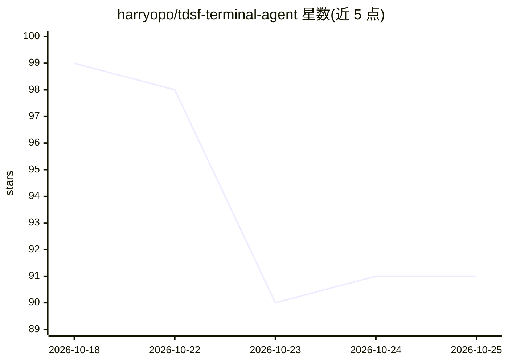

# harryopo/tdsf-terminal-agent

⭐ 91 · TypeScript · Apache-2.0 · 推送 2026-10-17 · [GitHub](https://github.com/harryopo/tdsf-terminal-agent) · [官网](https://harryopo.github.io/tdsf-terminal-agent/) · 个人维护 · 中文 README

**终端优先的 Linux AI 运维工作台，Agent 在真实 shell 中执行并逐步审批**

Tauri 2 桌面应用，面向 Linux 运维人员与学习者：本地 PTY、WSL、SSH 会话、SFTP 文件浏览编辑、CodeMirror 编辑器，加一个接入执行链路的 AI 运维 Agent（Strands Agents 驱动，25 个注册工具）。关键机制包括：命令逐字符写入可见终端并真实回显、四档权限（观察/确认/自动/教学）、命令影响分级与人工审批卡、灾难性操作硬拦截、熔断与退出码如实上报；本地知识检索用 SQLite FTS5 + sqlite-vec 向量双路 RRF 融合。限制：当前为 0.x 预稳定版，仅提供 Windows x64 安装包，未做 Authenticode 签名。

## 筛选速览

| 维度 | 判定 | 备注 |
|---|---|---|
| AI 角色 | `ai-native` | 本体是模型或模型工具 |
| 许可风险 | `permissive` | Apache-2.0 |
| 部署形态 | `desktop` | 安装包/桌面程序 |
| 模型依赖 | local-ok | 支持本地模型 |
| 硬件要求 | — | 无带数字的原话,不猜 |
| 安装摩擦 | `low` | 无编译、无系统依赖或容器化 |
| 成熟度 | `idea` | |

## 能力要点

- 可见终端模式下 Agent 命令逐字符写入真实 shell，输出回流工具卡
- 四档权限（观察/确认/自动/教学）与命令影响分级、审批卡、灾难操作硬拦截
- 纯 Rust SSH 客户端（russh），凭据存 Windows 密钥库，TOFU 主机密钥校验
- 本地知识检索：FTS5 关键词 + sqlite-vec 向量（BGE-small-zh，512 维）RRF 融合

## 适用场景

- 在 SSH/本地/WSL 终端里让 Agent 以人在回路方式执行运维操作并逐条审批
- Linux 运维教学：一次一张命令卡，预测回显与真实输出对照学习
- 通过 SFTP 与远程文件树管理远端服务器文件
- 本机知识库检索与运维案例复盘召回

## 场景标签

`AI 助手` · 领域:对话与助手

## 证据(README 行号)

> L41: TDSF Terminal Agent 是一款桌面终端工作台：本地 PTY、WSL、SSH 会话、编辑器、文件树，加上一个**接进执行链路的 AI 运维 Agent** —— 不是"终端旁边挂一个聊天框"。
> L54: - 单一 `main` Agent，由 Strands Agents 驱动；**工具注册表是实现、Schema 与策略的唯一真源**，模型看到的参数与代码接收的参数由门禁钉住一致。
> L140: |Agent 运行时|Python sidecar + Strands Agents（DeepSeek / 智谱 / 通义 / Kimi / 豆包 / Ollama / 自定义 OpenAI 兼容端点）|

## 星数曲线

2026-10-18 99 → 2026-10-25 91（-8）

---
*卡片 v1 · prompt 1.4 · 生成 2026-10-23 · 置信度 mid · 依据 README sha `ecfda64f46c2` · [字段定义](../../DATASET.md)*
