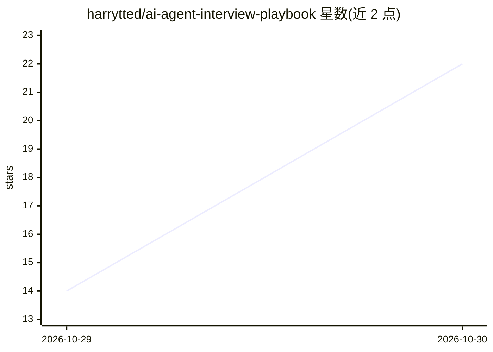

# harrytted/ai-agent-interview-playbook

⭐ 22 · Python · MIT · 推送 2026-10-28 · [GitHub](https://github.com/harrytted/ai-agent-interview-playbook) · [官网](https://harrytted.github.io/ai-agent-interview-playbook/) · 个人维护 · 中文 README

**AI Agent／大模型应用工程师中文学习与面试手册**

面向 AI Agent / 大模型应用工程师的中文学习仓库：10 章基础、12 章进阶课程，92 道原创详解题，每题含口述短答、详细答案、3 个追问、实战案例与验收练习，共 276 组追问、92 个案例，题目与章节双向链接。附在线阅读站、术语字典与技术博客（均为作者维护）。实验部分为 Python 3.10+ 标准库脚本（抽题复习、工具循环实验），无需联网、依赖或密钥；当前实验用脚本决策器和关键词检索，模型接入留作后续练习。

## 筛选速览

| 维度 | 判定 | 备注 |
|---|---|---|
| AI 角色 | `ai-knowledge` | 知识聚合/清单类 |
| 许可风险 | `permissive` | MIT |
| 部署形态 | `None` |  |
| 模型依赖 | — | README 未给出锁定关系 |
| 硬件要求 | — | 无带数字的原话,不猜 |
| 安装摩擦 | `low` | 无编译、无系统依赖或容器化 |
| 成熟度 | — | 结构信号不足 |

## 能力要点

- 10 章基础 + 12 章进阶课程与 92 道详解面试题，题目与章节双向链接
- 276 组追问与 92 个实战案例，覆盖 RAG、MCP、多 Agent、评测、安全等主题
- 离线实验仅需 Python 3.10+ 标准库，无需联网、依赖或 API 密钥
- 配套在线阅读手册、术语字典与技术博客，均由作者维护

## 适用场景

- 系统学习 Agent / LLM 应用工程并准备面试
- 闭卷刷题、答追问并复盘解释不清的机制
- 运行离线实验观察重试、审批、幂等等执行器边界

## 场景标签

`教程课程` · 领域:学习与行业

## 证据(README 行号)

> L5: 面向 **AI Agent / 大模型应用工程师**，以 Python 实践为主。仓库包含 **10 章基础、12 章进阶、92 道原创详解题**，配有数值算例、执行器与恢复实验、项目工作坊、学习路线和模拟面试。
> L7: 全部题目都有口述短答、详细答案、3 个带回答的追问、实战案例、误区与验收练习，共 **276 组追问、92 个案例**。每题直接链接对应学习内容，章节末尾也能找到相关题目。

## 星数曲线

2026-10-29 14 → 2026-10-30 22（+8）

---
*卡片 v1 · prompt 1.4 · 生成 2026-10-30 · 置信度 high · 依据 README sha `2494a5a3ea0a` · [字段定义](../../DATASET.md)*
