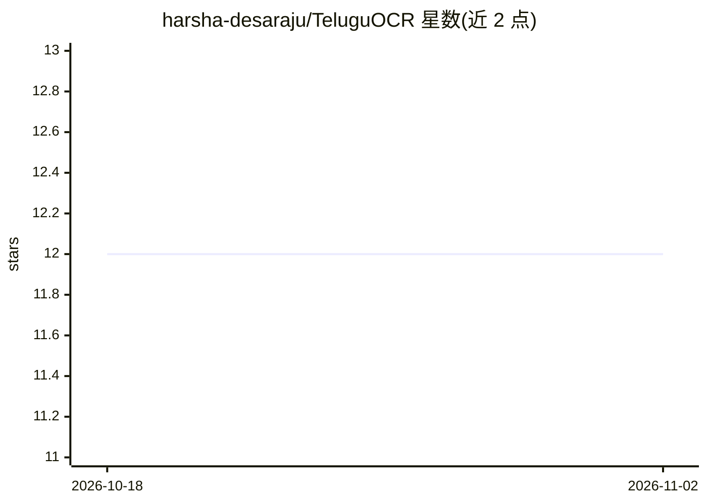

# harsha-desaraju/TeluguOCR

⭐ 12 · Jupyter Notebook · MIT · 推送 2026-10-12 · [GitHub](https://github.com/harsha-desaraju/TeluguOCR) · 个人维护

**泰卢固语行级 OCR 模型：CTC 编码器+字形级语言模型**

从零训练的泰卢固语文本行 OCR 系统：卷积 CTC 图像编码器经交叉注意力接入字形级（akshara）语言模型，81.1M 参数，联合重打分输出转录文本。自定义 PyTorch 实现，包括基于 Unicode 扩展字形簇的分词器（词表 2,048 个 akshara）、合成数据退化管线与 Wikisource 对齐语料。在 1,044 条人工标注测试行上报告 CER/akshara ER/WER，并与 Tesseract、PaddleOCR、Surya 基线对照。需 Python 3.12 与 uv，训练脚本内置 Kaggle 路径需自行修改。

## 筛选速览

| 维度 | 判定 | 备注 |
|---|---|---|
| AI 角色 | `ai-native` | 本体是模型或模型工具 |
| 许可风险 | `permissive` | MIT |
| 部署形态 | `None` |  |
| 模型依赖 | — | README 未给出锁定关系 |
| 硬件要求 | — | 无带数字的原话,不猜 |
| 安装摩擦 | `low` | 无编译、无系统依赖或容器化 |
| 成熟度 | — | 结构信号不足 |

## 能力要点

- CTC 编码器 + 字形级语言模型 + 联合重打分（1.19% CER，71.7% 整行准确）
- 字形簇级分词器，词表 2,048 个 akshara，无需 BPE
- 合成数据退化管线按 8 项统计对照真实裁剪行校准
- 四阶段训练流程与三项回归测试（checkpoint 兼容/微训练曲线/引擎等价）

## 适用场景

- 转录泰卢固语扫描书籍的文本行
- 对比泰卢固语 OCR 引擎的错误率
- 复现合成数据与 Wikisource 对齐的数据管线

## 场景标签

`OCR` · 领域:感知与多模态

## 证据(README 行号)

> L3: A Telugu line-OCR system trained from scratch — a convolutional CTC image encoder feeding
> L8: On a held-out set of **1,044 human-verified lines** from scanned Telugu books, it reads

## 星数曲线

2026-10-18 12 → 2026-11-02 12（+0）

---
*卡片 v1 · prompt 1.4 · 生成 2026-11-01 · 置信度 high · 依据 README sha `677162989de5` · [字段定义](../../DATASET.md)*
