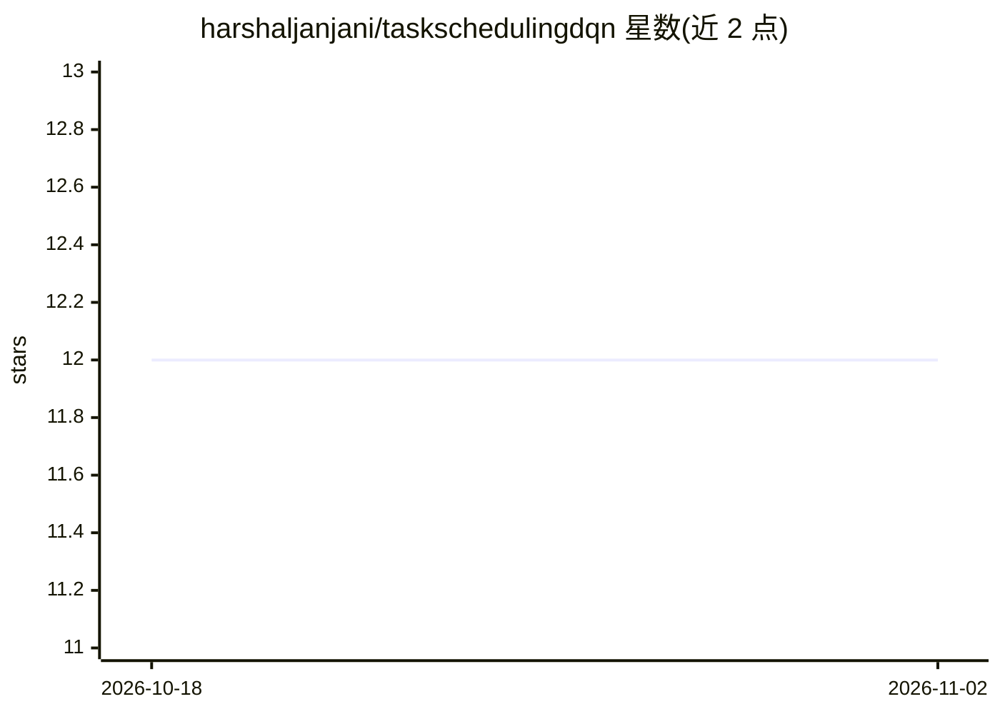

# harshaljanjani/taskschedulingdqn

⭐ 12 · Jupyter Notebook · Apache-2.0 · 推送 2026-07-18 · [GitHub](https://github.com/harshaljanjani/taskschedulingdqn) · 个人维护

**云环境节能任务调度与分配的强化学习算法研究代码**

IEEE TCSS 2024 论文的配套仓库，提出面向云环境的能耗感知任务调度与分配算法，使用在线强化学习（DQN）进行多目标优化，目标包括任务调度、资源管理与降低能耗。README 仅提供论文出处、引用格式（IEEE/BibTeX）、关键词与 Apache 2.0 许可信息，未包含安装、运行或代码使用说明，具体实现细节需查看仓库代码本身。

## 筛选速览

| 维度 | 判定 | 备注 |
|---|---|---|
| AI 角色 | `ai-native` | 本体是模型或模型工具 |
| 许可风险 | `permissive` | Apache-2.0 |
| 部署形态 | `None` |  |
| 模型依赖 | — | README 未给出锁定关系 |
| 硬件要求 | — | 无带数字的原话,不猜 |
| 安装摩擦 | `low` | 无编译、无系统依赖或容器化 |
| 成熟度 | — | 结构信号不足 |

## 能力要点

- 能耗感知的云任务调度与分配算法
- 基于在线强化学习（DQN）的多目标优化
- 发表于 IEEE Transactions on Computational Social Systems（DOI: 10.1109/TCSS.2024.3508089）

## 适用场景

- 引用或复现论文中的调度算法
- 研究云环境能耗与性能的多目标优化方法
- 作为任务调度强化学习研究的参考实现

## 场景标签

 · 领域:云计算/强化学习调度

## 证据(README 行号)

> L1: ### TaskSchedulingDQN: Energy-Aware Scheduling and Task Allocation in Cloud Environments
> L44: - Reinforcement Learning

## 星数曲线

2026-10-18 12 → 2026-11-02 12（+0）

---
*卡片 v1 · prompt 1.4 · 生成 2026-11-01 · 置信度 mid · 依据 README sha `0445db1ee8a4` · [字段定义](../../DATASET.md)*
