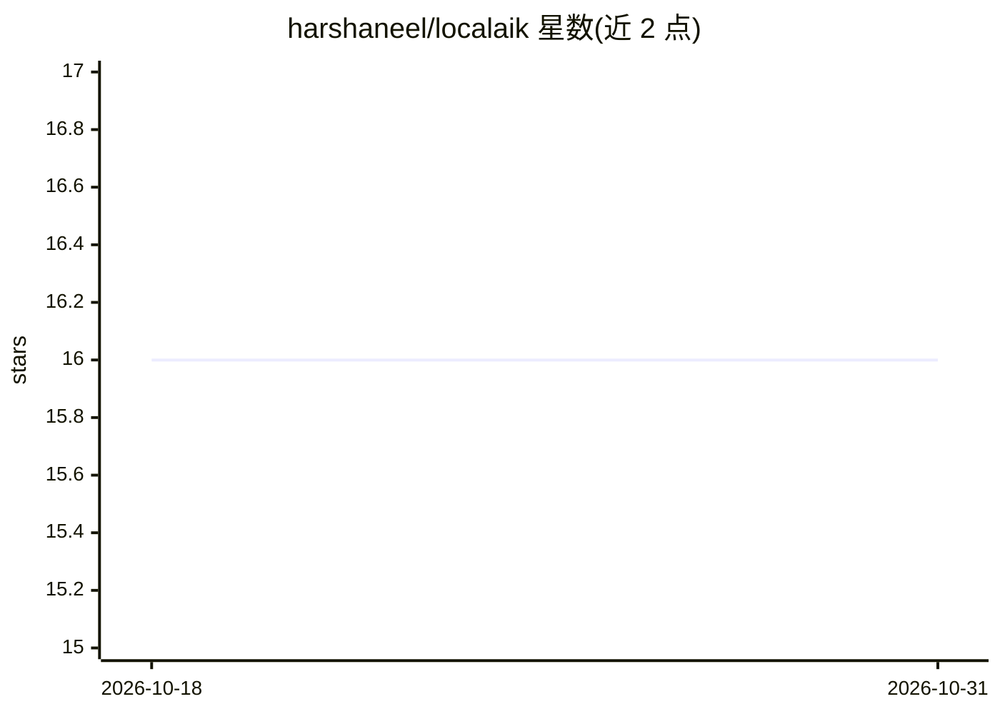

# harshaneel/localaik

⭐ 16 · Go · MIT · 推送 2026-08-06 · [GitHub](https://github.com/harshaneel/localaik) · 个人维护

**本地 API 兼容服务器：单容器同时提供 Gemini/OpenAI/Anthropic 协议**

面向测试与开发的本地兼容服务器：单个 Docker 容器在同一端口（默认 8090）提供 Gemini、OpenAI、Anthropic 三种协议形态，内部由 llama.cpp 运行 Gemma 3 模型；模型捆绑镜像无需 API key 与联网。proxy 标签不含模型，将请求翻译后转发到用户自备的 OpenAI 兼容上游（如 llama.cpp、vLLM）。实现了三方的聊天、流式、结构化输出、工具调用与 countTokens 等路由，并有自动化契约测试覆盖 Go/Python SDK。容器不对调用方做鉴权，文档明确其定位是测试工具而非网关。

## 筛选速览

| 维度 | 判定 | 备注 |
|---|---|---|
| AI 角色 | `ai-ecosystem` | LLM/agent 周边工具 |
| 许可风险 | `permissive` | MIT |
| 部署形态 | `self-host` | docker 或自建部署 |
| 模型依赖 | — | README 未给出锁定关系 |
| 硬件要求 | — | 无带数字的原话,不猜 |
| 安装摩擦 | `low` | 无编译、无系统依赖或容器化 |
| 成熟度 | — | 结构信号不足 |

## 能力要点

- 单端口同时服务 Gemini/OpenAI/Anthropic 三种协议
- 模型捆绑镜像（Gemma 3 4B/12B）无需 API key 与联网，可用于 CI
- proxy 标签可对接自备的 llama.cpp/vLLM 等 OpenAI 兼容上游
- Gemini 侧支持图像/PDF 输入、结构化输出、函数调用与 SSE 流式

## 适用场景

- 本地与 CI 环境中测试调用三家 API 的代码，替代真实 API 调用
- 同一测试套件内混用 Gemini/OpenAI/Anthropic SDK 而无需多个服务
- 已有自建模型服务器时，为其补齐 Gemini/Anthropic 协议入口

## 场景标签

`推理引擎` · 领域:训练与推理

## 证据(README 行号)

> L10: A local compatibility server for the Gemini, OpenAI, and Anthropic APIs. Run one container, point your SDK at `http
> L25: SDK requests hit the localaik proxy, which translates Gemini, OpenAI, or Anthropic wire format and forwards to the 
> L221: network. localaik is a testing tool, not a gateway.

## 星数曲线

2026-10-18 16 → 2026-10-31 16（+0）

---
*卡片 v1 · prompt 1.4 · 生成 2026-10-30 · 置信度 high · 依据 README sha `0f89abd094d2` · [字段定义](../../DATASET.md)*
