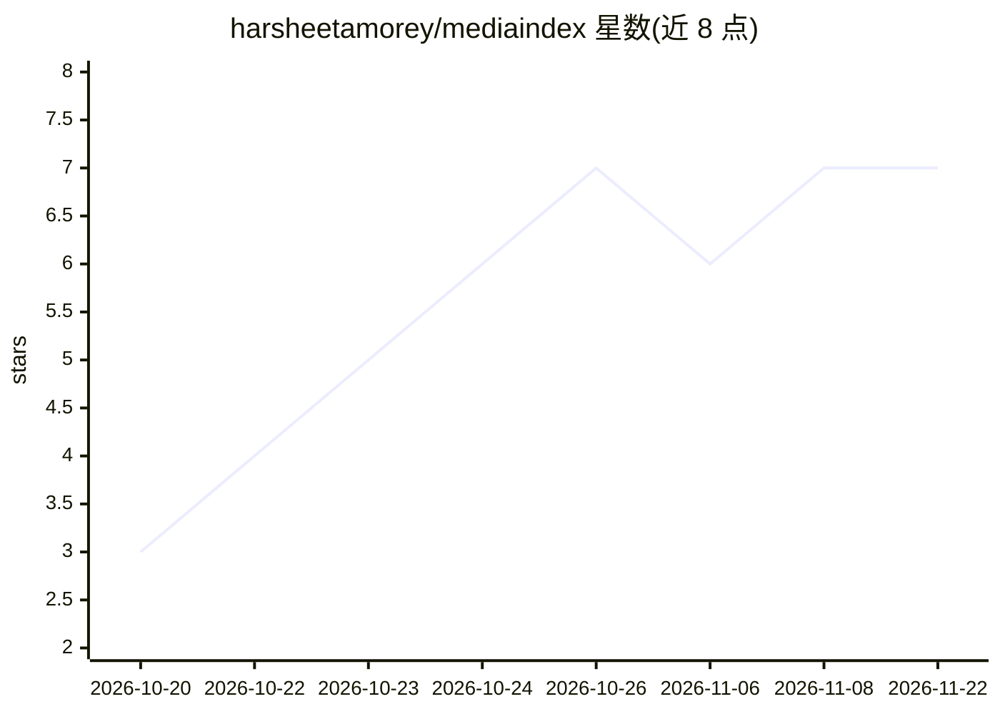

# harsheetamorey/mediaindex

⭐ 7 · Python · Apache-2.0 · 推送 2026-10-22 · [GitHub](https://github.com/harsheetamorey/mediaindex) · 个人维护

**本地 Mac 照片语义搜索与对话编辑工具**

面向照片库的本地应用：用 EmbeddingGemma 2 对照片/音频/视频做语义搜索，用 RT-DETR 计数与定位物体，用 SAM+LaMa 移除物体，用 Stable Diffusion 1.5 inpainting 替换或生成新图（另存新文件，不改动原图）。可选通过 Ollama 运行 Gemma 4 E2B 理解自由提问与描述照片。全部模型本地运行，无上传与遥测，支持离线。提供 macOS（Apple silicon）与 Windows x64 安装包，也可从源码运行。

## 筛选速览

| 维度 | 判定 | 备注 |
|---|---|---|
| AI 角色 | `ai-native` | 本体是模型或模型工具 |
| 许可风险 | `permissive` | Apache-2.0 |
| 部署形态 | `desktop` | 安装包/桌面程序 |
| 模型依赖 | local-ok | 支持本地模型 |
| 硬件要求 | — | 无带数字的原话,不猜 |
| 安装摩擦 | `medium` | 含编译或系统依赖之一 |
| 成熟度 | — | 结构信号不足 |

## 能力要点

- 文本/图片查询跨图像、声音、视频时刻的本地语义搜索
- 自然语言物体移除（SAM+LaMa）与替换/生成（SD 1.5 inpainting）
- 可选 Ollama + Gemma 4 E2B 实现自由对话与照片描述
- 离线运行验证：沙箱阻断网络并记录零外发连接

## 适用场景

- 用自然语言在本地照片库中找图、数物体
- 移除或替换照片中的物体且保留原图
- 按描述定位视频片段并导出剪辑
- 断网环境下管理私人照片库

## 场景标签

`语义搜索` `图像生成` `多模态` `图像视频处理` · 领域:内容生成

## 证据(README 行号)

> L3: **Chat with your photos. Edit them. Offline.**
> L43: |Search text, images, sounds and video|EmbeddingGemma 2 (Google DeepMind)|
> L125: After setup, `python -m mediaindex` forces offline model loading (`HF_HUB_OFFLINE=1` and `local_files_only`) and d

## 星数曲线

2026-10-20 3 → 2026-11-22 7（+4）

---
*卡片 v1 · prompt 1.4 · 生成 2026-11-20 · 置信度 high · 依据 README sha `daa735fe90b1` · [字段定义](../../DATASET.md)*
