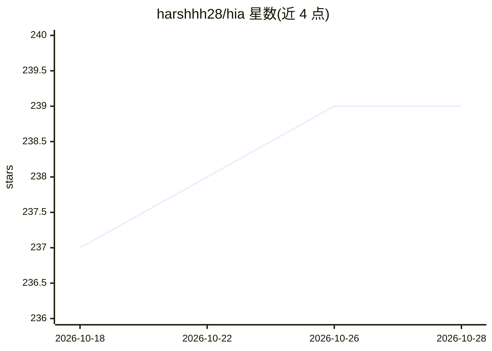

# harshhh28/hia

⭐ 239 · Python · MIT · 推送 2026-03-06 · [GitHub](https://github.com/harshhh28/hia) · [官网](https://hiahealth.streamlit.app) · 个人维护

**分析血液检验报告并提供健康洞察的 AI Agent 应用**

基于 Streamlit 的 Web 应用：用户上传血液检验 PDF（上限 20MB/50 页），由分析 Agent 结合内置知识库生成健康洞察，再由聊天 Agent 通过 RAG（FAISS + HuggingFace 嵌入）对报告进行追问问答。LLM 经 Groq 接入并配置四级模型级联回退；数据与会话存于 Supabase，提供 Supabase Auth 登录、多会话管理与每日分析次数上限（默认 15 次）。安装需 Python 3.8+、Groq API key 与 Supabase 账号，并按 SQL 脚本建表。

## 筛选速览

| 维度 | 判定 | 备注 |
|---|---|---|
| AI 角色 | `ai-native` | 本体是模型或模型工具 |
| 许可风险 | `permissive` | MIT |
| 部署形态 | `library` | 以包/库形式分发 |
| 模型依赖 | locked-api |  |
| 硬件要求 | — | 无带数字的原话,不猜 |
| 安装摩擦 | `low` | 无编译、无系统依赖或容器化 |
| 成熟度 | — | 结构信号不足 |

## 能力要点

- 双 Agent 架构：分析 Agent（含知识库与上下文学习）+ RAG 追问聊天 Agent
- Groq 四级模型级联回退（llama-4-maverick → llama-3.3-70b → llama-3.1-8b → llama3-70b-8192）
- Supabase 认证、多会话存储与历史管理
- PDF 上传校验（类型/医学内容）与每日分析限额

## 适用场景

- 上传血液检验报告获取健康洞察分析
- 对自己的报告进行追问式问答
- 管理多次报告分析会话与历史记录

## 场景标签

`文档问答` · 领域:知识与检索

## 证据(README 行号)

> L3: AI Agent to analyze blood reports and provide detailed health insights.
> L22:  - **Chat Agent**: RAG-powered follow-up Q&A over your report (FAISS + HuggingFace embeddings)
> L36:  - **Report analysis**: Groq with multi-model fallback via `ModelManager`

## 星数曲线

2026-10-18 237 → 2026-10-28 239（+2）

---
*卡片 v1 · prompt 1.4 · 生成 2026-10-22 · 置信度 high · 依据 README sha `8a4b8f565250` · [字段定义](../../DATASET.md)*
