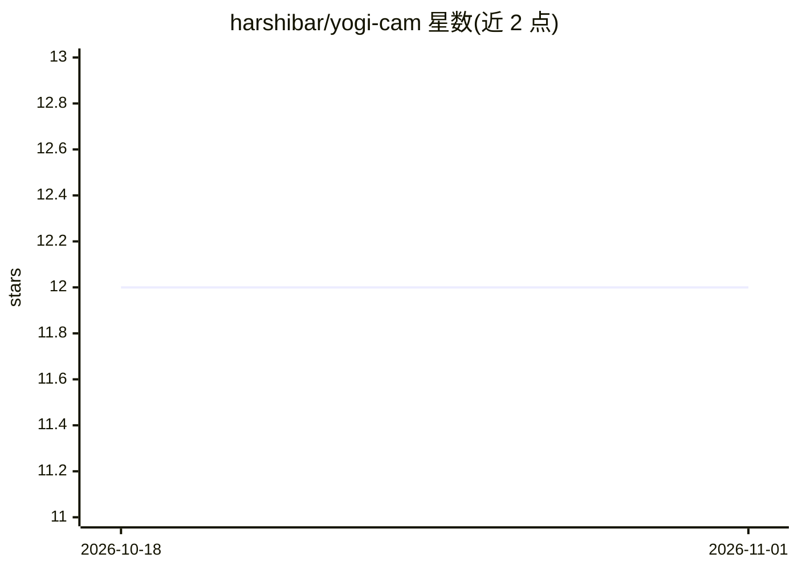

# harshibar/yogi-cam

⭐ — · [GitHub]() · 个人维护

**用 Claude 辅助开发的树莓派狗狗看护摄像头**

作者为陪伴分离焦虑犬训练而自建的 DIY 摄像头项目：树莓派 + 摄像头模块，用 Python + PiCamera2 采集视频，经 Flask 渲染网页直播，配合 ngrok 生成公网 URL 使手机在蜂窝网络下也可观看；另加内置秒表功能记录训练时长。代码由 Claude 辅助生成与迭代（需求 → MVP 约 2 天）。音频采集、自动吠叫检测、一键启动为未来计划。启动需数个手动步骤，说明见 instructions.md。

## 筛选速览

| 维度 | 判定 | 备注 |
|---|---|---|
| AI 角色 | `ai-enhanced` | 去掉 AI 部分产品仍成立 |
| 许可风险 | `permissive` | — |
| 部署形态 | `None` |  |
| 模型依赖 | — | README 未给出锁定关系 |
| 硬件要求 | — | 无带数字的原话,不猜 |
| 安装摩擦 | `low` | 无编译、无系统依赖或容器化 |
| 成熟度 | — | 结构信号不足 |

## 能力要点

- 树莓派 + PiCamera2 + Flask 网页视频直播
- ngrok 生成公网 URL，支持蜂窝网络远程观看
- 内置秒表记录训练会话时长
- 代码由 Claude 生成并迭代功能

## 适用场景

- 宠物独自在家时远程查看直播
- 配合分离焦虑训练记录吠叫时间戳
- 训练会话中同时看画面和计时

## 场景标签

 · 领域:物联网/宠物看护

## 证据(README 行号)

> L11: - Python + PiCamera2 + Flask to livestream to a HTML site
> L13: - Claude to write the code and connect everything

## 星数曲线

2026-10-18 12 → 2026-11-01 12（+0）

---
*卡片 v1 · prompt 1.4 · 生成 2026-11-01 · 置信度 mid · 依据 README sha `3a99641d7b94` · [字段定义](../../DATASET.md)*
