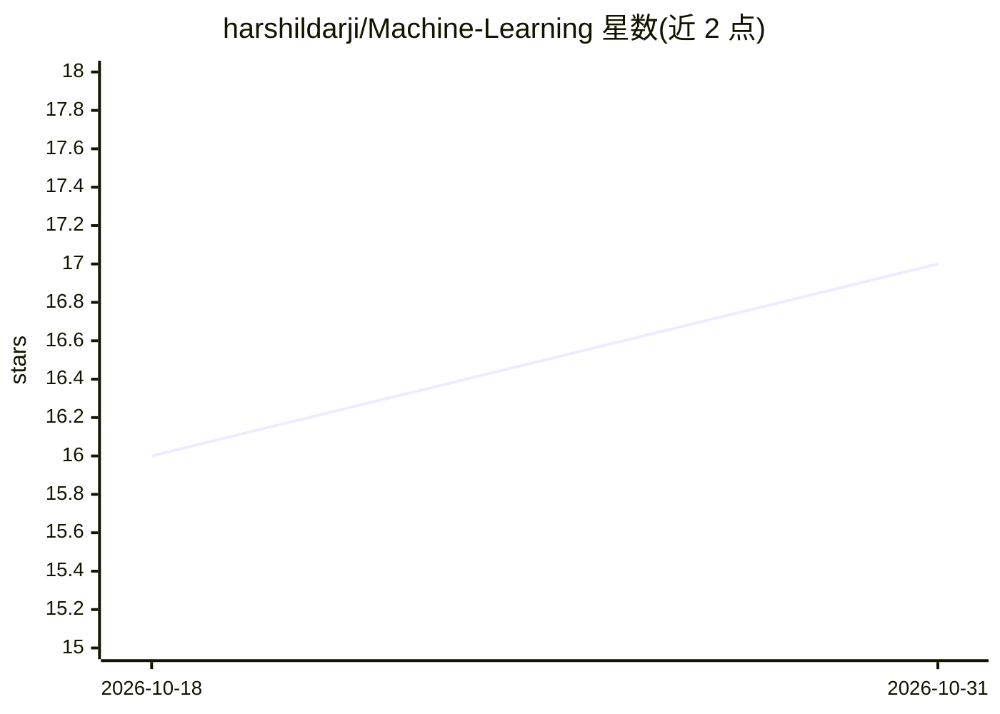

# harshildarji/Machine-Learning

⭐ 17 · Jupyter Notebook · 推送 2026-10-23 · [GitHub](https://github.com/harshildarji/Machine-Learning) · 个人维护

**机器学习练习集：Jupyter notebook 实现的分类/识别/预测教程合集**

个人维护的机器学习实践仓库，内容以 Jupyter notebook 为主，覆盖 Transformers/BERT（词填充、NER、法律德文 NER、EsperBERTo）、情感分析、数字识别、人脸识别（照片/摄像头/视频）、PyTorch 从零构建神经网络与 RNN、TF1/TF2 官方教程复现、ARIMA 与 Prophet 时间序列预测（股价/比特币）、词嵌入与异常检测等。README 仅为目录式条目列表，未给出安装命令或运行说明，需要读者自行具备 Python/PyTorch/TensorFlow 环境。

## 筛选速览

| 维度 | 判定 | 备注 |
|---|---|---|
| AI 角色 | `ai-knowledge` | 知识聚合/清单类 |
| 许可风险 | `none` | — |
| 部署形态 | `None` |  |
| 模型依赖 | — | README 未给出锁定关系 |
| 硬件要求 | — | 无带数字的原话,不猜 |
| 安装摩擦 | `low` | 无编译、无系统依赖或容器化 |
| 成熟度 | — | 结构信号不足 |

## 能力要点

- BERT 系列实践：词填充、NER、法律德文 NER、EsperBERTo 预训练
- PyTorch 从零构建神经网络、RNN、TorchScript
- ARIMA 与 FB Prophet 时间序列预测（Apple 股价、比特币）
- 人脸识别覆盖照片、摄像头流与视频三种输入

## 适用场景

- 学习从零实现神经网络与 RNN 的代码
- 参考 BERT/Transformers 下游任务的 notebook 实现
- 对照 TF1/TF2 官方教程的练习代码

## 场景标签

`教程课程` · 领域:学习与行业

## 证据(README 行号)

> L1: # Machine Learning Practise
> L29: - TF 1 Tutorials
> L39: - TF 2 Tutorials

## 星数曲线

2026-10-18 16 → 2026-10-31 17（+1）

---
*卡片 v1 · prompt 1.4 · 生成 2026-10-30 · 置信度 mid · 依据 README sha `faffac8de034` · [字段定义](../../DATASET.md)*
