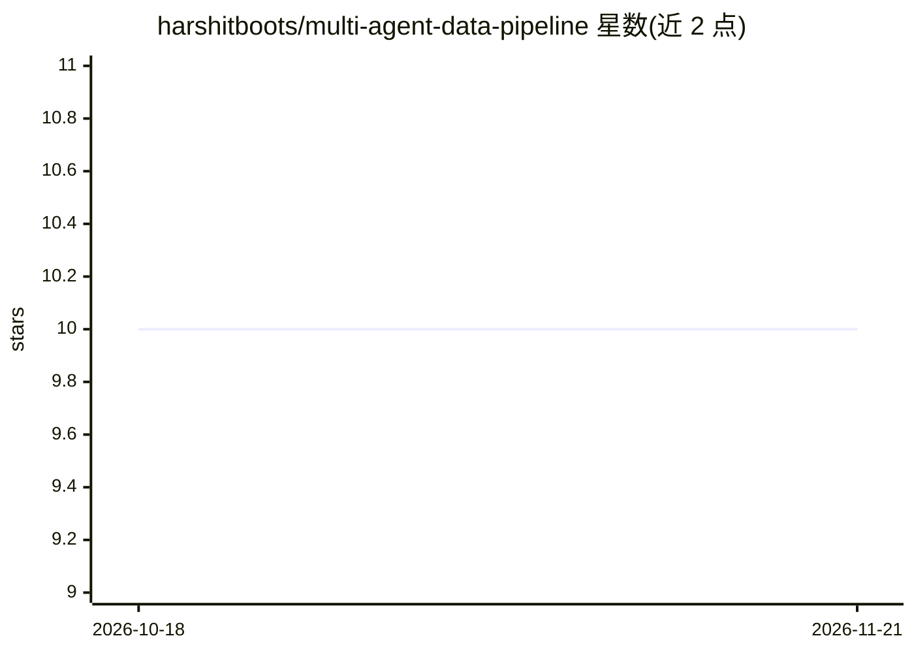

# harshitboots/multi-agent-data-pipeline

⭐ 10 · Python · MIT · 推送 2026-07-07 · [GitHub](https://github.com/harshitboots/multi-agent-data-pipeline) · 个人维护

**用 11 个 AI agent 自动清洗/校验/摘要 CSV、PDF 与数据库数据**

基于 Streamlit 的数据处理流水线：CSV 走 6 个 agent（清洗、PII 匿名化、校验、转换、异常检测、摘要），PDF 走 5 个 agent（解析、实体抽取、风险检测、行动项提取、摘要），数据库经连接器接入 Databricks/Snowflake/PostgreSQL/MySQL。Router Engine 按任务复杂度在 Haiku 与 Sonnet 间分配模型并统计成本。每次运行记录到 SQLite，仪表盘提供 7 个标签页观测成本、延迟与护栏事件。需 Anthropic API key，另提供免安装在线演示。

## 筛选速览

| 维度 | 判定 | 备注 |
|---|---|---|
| AI 角色 | `ai-native` | 本体是模型或模型工具 |
| 许可风险 | `permissive` | MIT |
| 部署形态 | `self-host` | docker 或自建部署 |
| 模型依赖 | locked-api |  |
| 硬件要求 | — | 无带数字的原话,不猜 |
| 安装摩擦 | `low` | 无编译、无系统依赖或容器化 |
| 成熟度 | — | 结构信号不足 |

## 能力要点

- CSV 六 agent 流水线：清洗、PII 匿名化、校验、转换、异常检测、摘要
- Router Engine 按任务复杂度分配 Haiku/Sonnet 模型并输出成本对比
- 每次运行持久化到 SQLite，观测仪表盘含成本分析、Agent 性能与护栏日志
- 数据库连接器支持 Databricks、Snowflake、PostgreSQL、MySQL

## 适用场景

- 快速清洗格式混乱、缺少文档的 CSV 数据
- 从合同、报表、发票等 PDF 中抽取实体与行动项
- 分析数据中的异常值与 PII 风险并生成业务摘要
- 直接连接数据库对表跑完整处理流水线

## 场景标签

`多智能体` `数据分析` `文档解析` · 领域:Agent 开发

## 证据(README 行号)

> L23: > *watch 11 AI agents autonomously clean, anonymise, validate, transform,*
> L69: Each agent has a single job, its own reasoning, and structured JSON output.
> L154: Six specialised agents process your CSV in sequence. The Router assigns Haiku or Sonnet per agent based on task co

## 星数曲线

2026-10-18 10 → 2026-11-21 10（+0）

---
*卡片 v1 · prompt 1.4 · 生成 2026-11-19 · 置信度 mid · 依据 README sha `a1b3ffcba096` · [字段定义](../../DATASET.md)*
