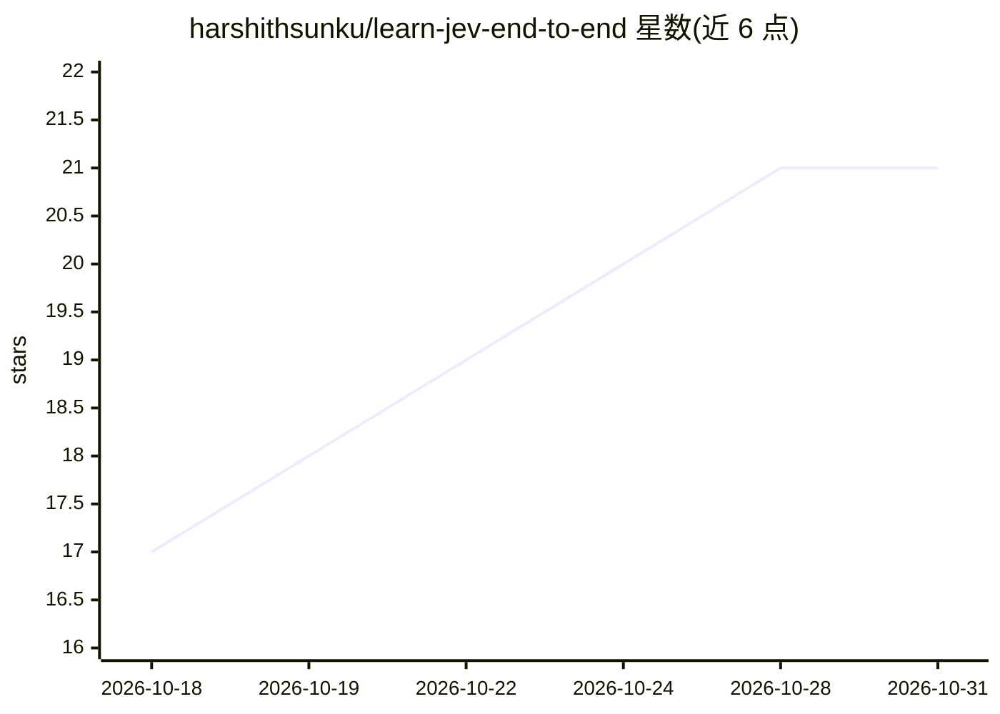

# harshithsunku/learn-jev-end-to-end

⭐ 21 · Jupyter Notebook · MIT · 推送 2026-09-23 · [GitHub](https://github.com/harshithsunku/learn-jev-end-to-end) · [官网](https://harshithsunku.github.io/learn-jev-end-to-end/) · 个人维护

**免费动手课程：用 Jev 决策模型与 LLM 构建 13 个 AI agent 用例**

面向会读 Python 的开发者的免费实践课程（12 个 Jupyter notebook），教授将 TypeSafe AI 的决策模型 Jev（快脑）与 LLM（慢脑）组合进 AI agent：在路由、工具选择、护栏、评判等 5 个位置接入 Jev，构建邮件分诊、诈骗短信检测、代码漏洞猎手、提示注入防护等 13 个用例。只需一个 OpenRouter key 即可运行全部内容，无 Jev 访问时可用 LLM 适配器后端替代（基准 notebook 除外）。附 Gradio 网页 playground、定时邮件分诊任务与配置自检脚本。

## 筛选速览

| 维度 | 判定 | 备注 |
|---|---|---|
| AI 角色 | `ai-knowledge` | 知识聚合/清单类 |
| 许可风险 | `permissive` | MIT |
| 部署形态 | `None` |  |
| 模型依赖 | locked-api |  |
| 硬件要求 | — | 无带数字的原话,不猜 |
| 安装摩擦 | `low` | 无编译、无系统依赖或容器化 |
| 成熟度 | — | 结构信号不足 |

## 能力要点

- 12 个 notebook 覆盖 13 个 agent 用例，均带真实输出提交
- Jev 决策点接入 agent 的 5 个位置：路由/工具/护栏/完成门/评判
- JEV_BACKEND=adapter 可用 LLM 替代 Jev 运行除基准外的全部 notebook
- 附 Gradio 网页 playground 与 setup doctor 自检脚本

## 适用场景

- 系统学习决策模型与 LLM 的组合用法
- 为邮件分诊、诈骗检测、护栏等场景找可复用实现
- 用低成本 eval 门禁接入 CI 流程

## 场景标签

`教程课程` · 领域:学习与行业

## 证据(README 行号)

> L19: **Learn Jev end to end** is a free, hands-on course. In 12 short notebooks you go from *"what is Jev?"* to
> L20: building **13 real AI tools** with it: an email triage job, a scam-text detector, a code vulnerability
> L98: |#|Lesson|What you'll learn|What you'll build|

## 星数曲线

2026-10-18 17 → 2026-10-31 21（+4）

---
*卡片 v1 · prompt 1.4 · 生成 2026-10-28 · 置信度 high · 依据 README sha `24deac55a1b7` · [字段定义](../../DATASET.md)*
