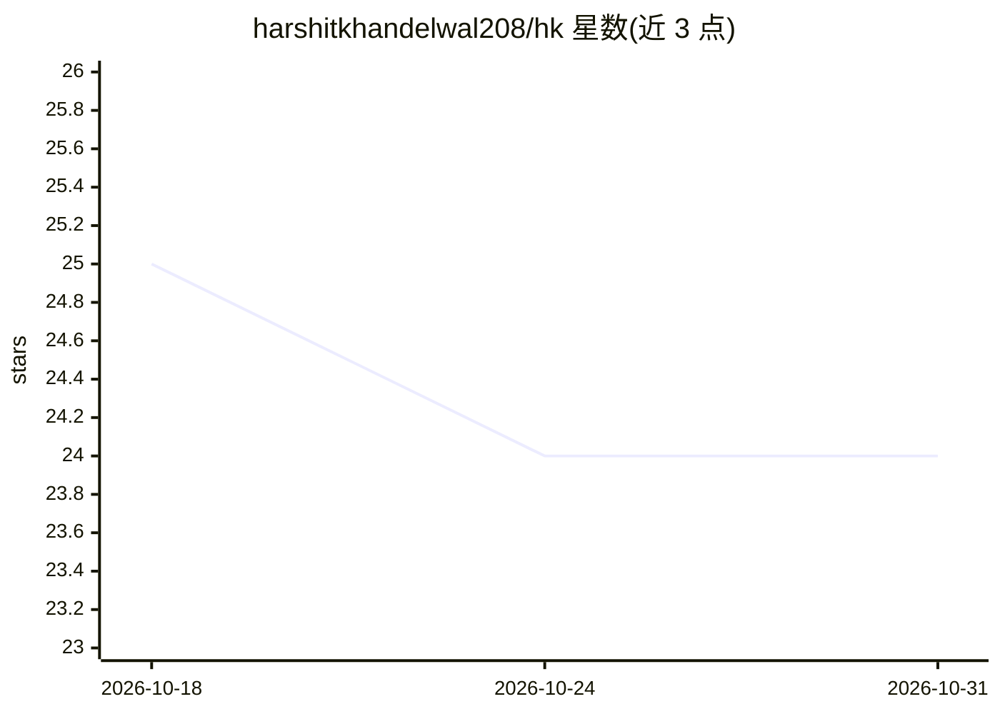

# harshitkhandelwal208/hk

⭐ 24 · Zig · Apache-2.0 · 推送 2026-10-22 · [GitHub](https://github.com/harshitkhandelwal208/hk) · 个人维护

**Zig 编写的本地 LLM 运行时与模型格式，含 OpenAI 兼容服务**

个人项目，从零实现的 LLM 推理运行时与 .hk 模型容器格式：权重零拷贝 mmap 加载、CPU/CUDA/Vulkan 三种引擎、26 种量化格式、GGUF/safetensors 流式下载转换、OpenAI 兼容服务端（流式/多会话/共享 prompt cache）。研究性功能包括 2:4 结构化稀疏（仅存储）、Net2Net 模型扩宽（原型）、文件内哈希链版本历史、自我学习循环（实验性）。限制：仅支持 Llama/Qwen2/Qwen3 类稠密模型，GPU 仅在一块 NVIDIA 笔记本 GPU 上测试。以 Zig 源码构建为主，另提供 Python/Node/Rust/C 等绑定。

## 筛选速览

| 维度 | 判定 | 备注 |
|---|---|---|
| AI 角色 | `ai-ecosystem` | LLM/agent 周边工具 |
| 许可风险 | `permissive` | Apache-2.0 |
| 部署形态 | `desktop` | 安装包/桌面程序 |
| 模型依赖 | — | README 未给出锁定关系 |
| 硬件要求 | — | 无带数字的原话,不猜 |
| 安装摩擦 | `medium` | 含编译或系统依赖之一 |
| 成熟度 | `idea` | |

## 能力要点

- 零拷贝 mmap 加载，CPU 私有内存比 llama.cpp 低 5-9 倍
- CUDA 内核用 Zig 编写，无需安装 CUDA toolkit；含 Vulkan 引擎
- OpenAI 兼容服务端：流式、多会话、共享 prompt cache、/metrics
- hk pull 边下载边转换 Hugging Face Hub 与 GGUF 仓库，SHA-256 校验

## 适用场景

- 在本地机器上以低内存占用运行 Llama/Qwen 类小模型
- 用 OpenAI 兼容 API 在本机部署推理服务
- 研究 Net2Net 模型生长与文件内版本历史等模型格式实验

## 场景标签

`推理引擎` · 领域:训练与推理

## 证据(README 行号)

> L5: A from-scratch LLM runtime and model format in Zig: zero-copy mmap loading, CPU / CUDA / Vulkan engines, an OpenAI-c
> L63: |**OpenAI-compatible server**|Streaming, many conversations at once, shared prompt cache|Working|
> L78: - **A real server.** `/v1/chat/completions` and `/v1/completions` with streaming, several conversations at once, a 

## 星数曲线

2026-10-18 25 → 2026-10-31 24（-1）

---
*卡片 v1 · prompt 1.4 · 生成 2026-10-27 · 置信度 high · 依据 README sha `bbe218efb67f` · [字段定义](../../DATASET.md)*
