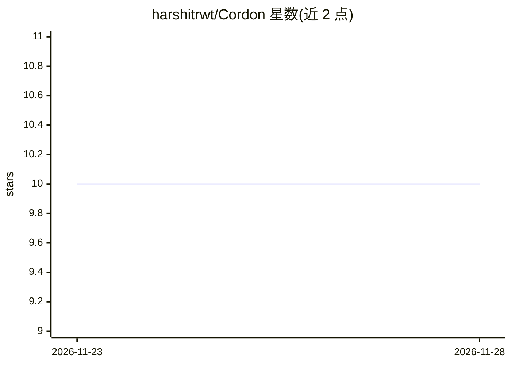

# harshitrwt/Cordon

⭐ 10 · TypeScript · 推送 2026-11-20 · [GitHub](https://github.com/harshitrwt/Cordon) · [官网](https://tinyurl.com/cordonguard) · 个人维护

**为 LLM 应用提供多层提示注入与越狱攻击的实时防火墙**

Cordon 是面向 LLM 应用的开源多层安全中间件，在提示词进入模型前进行实时检测与拦截。检测管线包含去混淆预处理（西里尔同形字、URL 编码、零宽字符）、TF-IDF 随机森林分类器、30+ 条多语言正则启发式规则，以及基于 Qdrant 向量检索的语义检测器，经加权融合层输出 SAFE/REVIEW/BLOCK 判定。提供 npm SDK（cordonguard，支持 Node.js/Express/Next.js 中间件与 OpenAI 包装器）、本地 Python 引擎和 Next.js Web 平台，另提供部署在 Google Cloud Run 的网关（免费层每月 5,000 次请求）。

## 筛选速览

| 维度 | 判定 | 备注 |
|---|---|---|
| AI 角色 | `ai-ecosystem` | LLM/agent 周边工具 |
| 许可风险 | `permissive` | — |
| 部署形态 | `library` | 以包/库形式分发 |
| 模型依赖 | local-ok | 支持本地模型 |
| 硬件要求 | — | 无带数字的原话,不猜 |
| 安装摩擦 | `low` | 无编译、无系统依赖或容器化 |
| 成熟度 | — | 结构信号不足 |

## 能力要点

- 五层检测管线：去混淆、ML 分类、多语言启发式规则、Qdrant 向量语义检索、加权融合
- npm SDK 提供本地内存模式，零外部网络请求、亚毫秒级延迟
- BLOCK 判定直接中止推理，README 声称减少令牌计算浪费与数据泄漏
- 零 PII 审计遥测：仅记录 SHA-256 提示词哈希，不保存原文

## 适用场景

- 为面向用户的 LLM 应用在推理前拦截提示注入与越狱攻击
- 为 Node.js/Express/Next.js 应用加一层安全中间件
- 搭建本地测试环境评估提示词的攻击风险评分

## 场景标签

`网络安全` · 领域:学习与行业

## 证据(README 行号)

> L17: **Cordon** is an open-source, multi-layered security firewall and middleware for Large Language Model (LLM) applica
> L86: - **Multi-Signal Learned Fusion**: Stacking Random Forest meta-classifier fuses statistical ML, pattern heuristics,

## 星数曲线

2026-11-23 10 → 2026-11-28 10（+0）

---
*卡片 v1 · prompt 1.4 · 生成 2026-11-23 · 置信度 high · 依据 README sha `60b79d3fce9c` · [字段定义](../../DATASET.md)*
