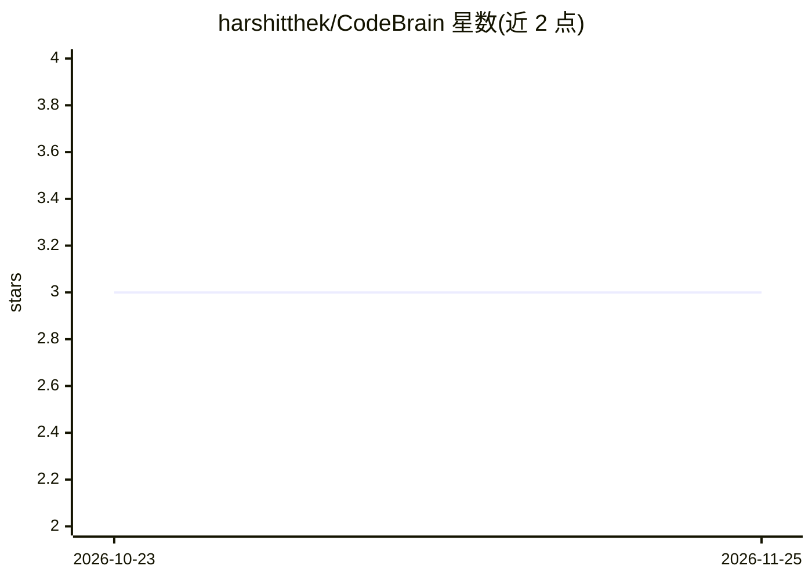

# harshitthek/CodeBrain

⭐ 3 · Python · Apache-2.0 · 推送 2026-10-25 · [GitHub](https://github.com/harshitthek/CodeBrain) · [官网](codebrainagent.vercel.app) · 组织维护

**面向 QA 团队的多 Agent 自动化 API 测试平台**

CodeBrain 是一个自主质量工程平台，将产品需求文档、API 规范与源代码转换为可执行测试套件。核心机制为 Actor-Critic 反思循环：Generator 与 Reviewer 迭代互评，带质量阈值与防回退的单一调优守卫；异步 httpx 运行器执行 HTTP 断言；内置 SQLite/Chroma 混合 RAG 检索（BM25+稠密向量融合），无需 Docker。支持从 PRD 分析、测试用例生成/评审到导出 Pytest、Postman、Jira、TestRail、JUnit XML 等格式，并提供 CI/CD 无头 CLI。通过 Fetch AgentChatProtocol 接入 ASI:One 聊天流程。

## 筛选速览

| 维度 | 判定 | 备注 |
|---|---|---|
| AI 角色 | `ai-native` | 本体是模型或模型工具 |
| 许可风险 | `permissive` | Apache-2.0 |
| 部署形态 | `library` | 以包/库形式分发 |
| 模型依赖 | local-ok | 支持本地模型 |
| 硬件要求 | — | 无带数字的原话,不猜 |
| 安装摩擦 | `low` | 无编译、无系统依赖或容器化 |
| 成熟度 | — | 结构信号不足 |

## 能力要点

- Actor-Critic 反思循环的生成/评审流水线，带单调回退守卫
- 零 Docker 混合 RAG：BM25+稠密向量倒数排名融合，SQLite/Chroma 嵌入式向量存储，可选 Milvus
- 运行时切换多家模型：DeepSeek、Qwen、OpenAI、Ollama（本地）、Groq 及 OpenAI 兼容网关
- 导出 Pytest/Postman/Jira/TestRail/XMind/JUnit XML，并提供 CI/CD CLI 运行器

## 适用场景

- 从 PRD 文档自动生成并评审测试用例套件
- 从 OpenAPI/Swagger/Postman 规范生成 API 契约测试并在 CI 中运行
- 将测试套件一键推送至 Jira/TestRail 等测试管理系统
- 通过 ASI:One 聊天完成需求→审批→pytest 验证的发布前 QA 流程

## 场景标签

`多智能体` `RAG` `代码生成` · 领域:Agent 开发

## 证据(README 行号)

> L17: **CodeBrain** is an autonomous quality engineering platform that transforms product requirements, API specification
> L98: |**Universal LLM Factory**|Runtime model switching across **DeepSeek**, **Qwen**, **OpenAI** (`gpt-4o-mini`), **Oll

## 星数曲线

2026-10-23 3 → 2026-11-25 3（+0）

---
*卡片 v1 · prompt 1.4 · 生成 2026-11-21 · 置信度 mid · 依据 README sha `6e8ec28770d7` · [字段定义](../../DATASET.md)*
