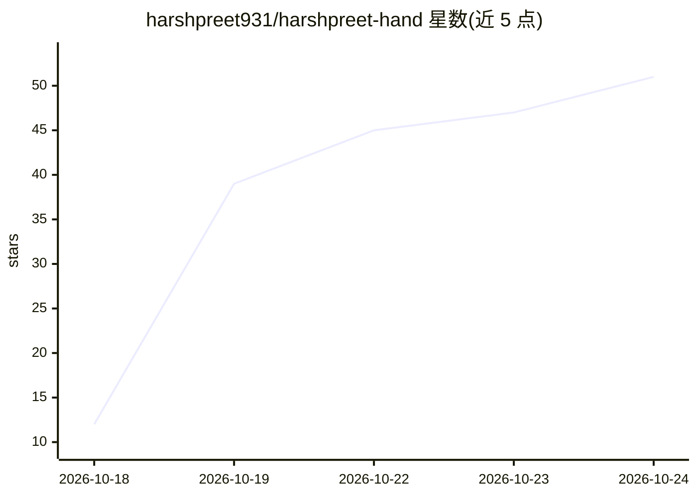

# harshpreet931/harshpreet-hand

⭐ 52 · Python · MIT · 推送 2026-10-17 · [GitHub](https://github.com/harshpreet931/harshpreet-hand) · [官网](https://harshpreet931.github.io/harshpreet-hand/) · 个人维护

**把120页手写笔记转成真实手写字体并开源流水线**

作者用 Claude Code 处理 120 页手写《计算机网络》笔记照片，生成可安装的手写字体 Harshpreet Hand（TTF/WOFF/WOFF2，OFL 1.1 许可）。流水线为一系列 Python 脚本：分离蓝色墨迹、切分单词、按 704 词转写对齐出 2,479 个字母样本、骨架化描摹笔迹、构建含 2–3 个变体轮换（calt）、风格替换（ss01）与 kerning 的 TrueType 字体。README 说明可用自己的笔记重建并调整各环节。局限：部分大写字母仅一样本，G/J/X 及标点由部件拼成，无 hinting。字体 MIT 独立、代码 MIT。

## 筛选速览

| 维度 | 判定 | 备注 |
|---|---|---|
| AI 角色 | `ai-native` | 本体是模型或模型工具 |
| 许可风险 | `permissive` | MIT |
| 部署形态 | `library` | 以包/库形式分发 |
| 模型依赖 | — | README 未给出锁定关系 |
| 硬件要求 | — | 无带数字的原话,不猜 |
| 安装摩擦 | `low` | 无编译、无系统依赖或容器化 |
| 成熟度 | — | 结构信号不足 |

## 能力要点

- 2,479 个字母样本，每字母 2–3 个真实变体轮换（calt）
- 七步流水线：墨迹分离→切分→转写对齐→样本排序→笔迹描摹→构字→TrueType 构建
- 提供从自己手写笔记生成字体的完整步骤与可调参数
- CSS 主题与 CDN 一行引入，附 specimen 页面

## 适用场景

- 网页或文档中使用自己的手写字体
- 把自己的手写笔记照片做成可安装字体
- 研究 OCR/字形提取到字体构建的流水线

## 场景标签

`图像视频处理` · 领域:感知与多模态

## 证据(README 行号)

> L3:  I gave Claude Code 120 pages of my handwritten college notes.
> L4:  It gave me back my handwriting, as a real font.
> L101: The source is `CN_CompleteNotes_FullSyllabus.pdf`:
> L105: |Step|Script (`pipeline/`)|What it does|

## 星数曲线

2026-10-18 12 → 2026-10-24 51（+39）

---
*卡片 v1 · prompt 1.4 · 生成 2026-10-24 · 置信度 high · 依据 README sha `5bea87d622d0` · [字段定义](../../DATASET.md)*
