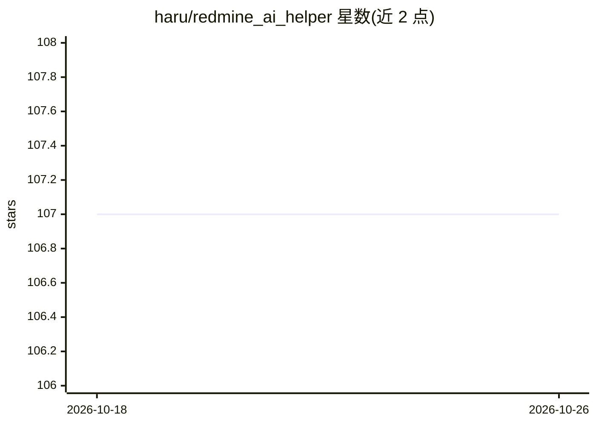

# haru/redmine_ai_helper

⭐ 107 · Ruby · MIT · 推送 2026-10-23 · [GitHub](https://github.com/haru/redmine_ai_helper) · [官网](https://www.redmine.org/plugins/redmine_ai_helper) · 个人维护

**为 Redmine 加 AI 聊天、智能补全与向量搜索的插件**

面向 Redmine 用户的 AI 辅助插件：在界面右侧添加 AI 聊天侧边栏，提供议题/Wiki 摘要、源码解释、子任务生成、行内补全（TAB 接受）、错字检查、经办人建议、待办建议、自定义命令与项目健康报告（含 REST API 与历史对比）。支持多模态附件分析（图片/PDF/文本/代码/音频），集成 MCP Server、Qdrant 向量搜索（相似议题与重复议题检测），并通过 Socket Mode 网关从 Slack 等外部聊天工具访问，网关以独立后台进程运行。向量搜索相关功能仅在配置后才可用。

## 筛选速览

| 维度 | 判定 | 备注 |
|---|---|---|
| AI 角色 | `ai-enhanced` | 去掉 AI 部分产品仍成立 |
| 许可风险 | `permissive` | MIT |
| 部署形态 | `self-host` | docker 或自建部署 |
| 模型依赖 | locked-api |  |
| 硬件要求 | — | 无带数字的原话,不猜 |
| 安装摩擦 | `low` | 无编译、无系统依赖或容器化 |
| 成熟度 | — | 结构信号不足 |

## 能力要点

- AI 聊天侧边栏与议题/Wiki 摘要、子任务生成、行内补全
- Qdrant 向量搜索：相似议题查找与新建议题查重（需配置）
- 项目健康报告：Markdown/PDF 导出、历史对比、REST API 与 cron 定时生成
- Slack 网关以独立进程外连运行，Redmine 无需公网 URL

## 适用场景

- 在 Redmine 中直接向 AI 提问、总结议题与 Wiki 内容
- 写议题和 Wiki 时获得行内补全与错字纠正
- 通过向量搜索发现相似历史议题、避免重复建单
- 用 Slack 在聊天工具中访问 Redmine AI 助手

## 场景标签

`AI 助手` `语义搜索` · 领域:对话与助手

## 证据(README 行号)

> L13: The Redmine AI Helper Plugin adds AI chat functionality to Redmine, enhancing project management efficiency through
> L32: - MCP server integration

## 星数曲线

2026-10-18 107 → 2026-10-26 107（+0）

---
*卡片 v1 · prompt 1.4 · 生成 2026-10-23 · 置信度 mid · 依据 README sha `032a2bc7932a` · [字段定义](../../DATASET.md)*
