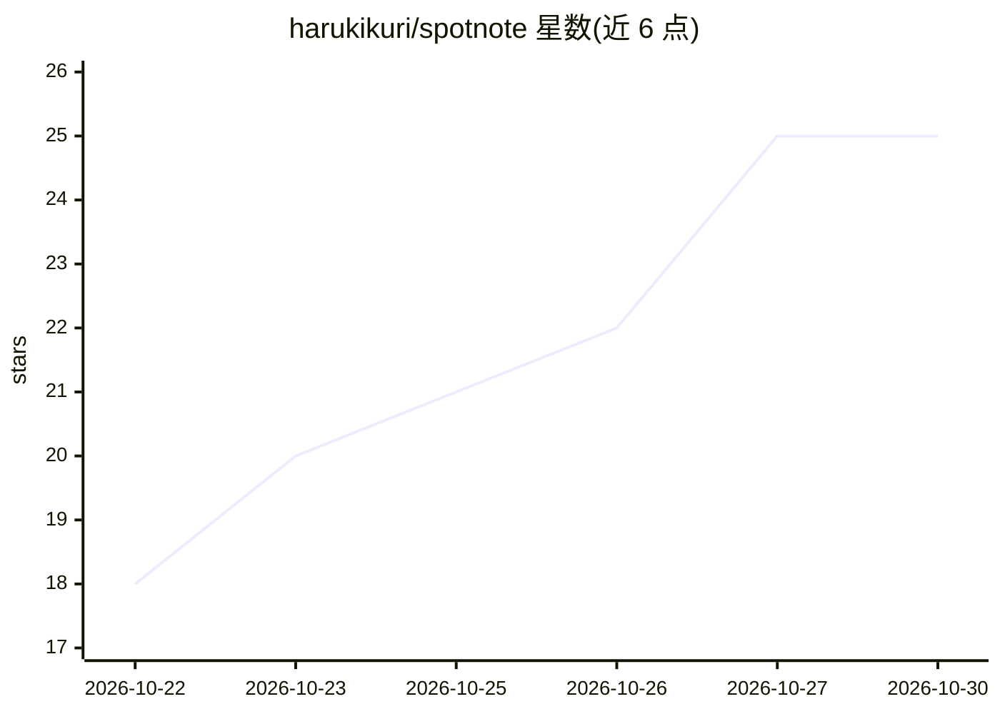

# harukikuri/spotnote

⭐ 25 · TypeScript · MIT · 推送 2026-10-28 · [GitHub](https://github.com/harukikuri/spotnote) · [官网](https://spotnote-weld.vercel.app) · 个人维护

**让前端 UI 反馈直达编码 agent 的 Vite 插件**

面向使用编码 agent（如 Claude Code、Cursor、Codex）的前端开发者的 Vite 插件：在运行中的应用里点击任意元素、写下修改意见，即生成指向源码精确文件/行/列的提示词复制到剪贴板，粘贴给 agent。支持任意 Vite 框架（React/Vue/Svelte/Solid/Astro），应用代码零导入；仅在 vite dev 或指定 staging 构建中运行，全部本地、无账号无云端。另支持 webhook 将备注（含截图、提交号）以 JSON 推送到团队聊天或 issue 跟踪器。要求 Vite 5+ 与 Node 22+。

## 筛选速览

| 维度 | 判定 | 备注 |
|---|---|---|
| AI 角色 | `ai-ecosystem` | LLM/agent 周边工具 |
| 许可风险 | `permissive` | MIT |
| 部署形态 | `library` | 以包/库形式分发 |
| 模型依赖 | — | README 未给出锁定关系 |
| 硬件要求 | — | 无带数字的原话,不猜 |
| 安装摩擦 | `low` | 无编译、无系统依赖或容器化 |
| 成熟度 | — | 结构信号不足 |

## 能力要点

- 点击 UI 元素生成含精确文件/行/列的 agent 提示词
- 任意 Vite 框架可用，应用代码零导入
- 仅在 dev/staging 构建运行，生产构建不受影响
- webhook 推送备注（JSON，可附截图）到团队聊天或 issue 工具

## 适用场景

- 前端开发中把视觉修改意见直接转成带代码位置的 agent 提示词
- staging 部署上让评审者提交带截图与代码位置的反馈
- 把 UI 反馈自动汇入团队聊天或 issue 跟踪器

## 场景标签

`提示工程` · 领域:Agent 开发

## 证据(README 行号)

> L6: **Spotnote** is a Vite plugin for UI feedback to coding agents. Click any element in your running app, write what sh
> L40: Start your dev server and click the launcher in the bottom-left corner. Click an element, type what should change a

## 星数曲线

2026-10-22 18 → 2026-10-30 25（+7）

---
*卡片 v1 · prompt 1.4 · 生成 2026-10-27 · 置信度 high · 依据 README sha `13e943a30a2d` · [字段定义](../../DATASET.md)*
