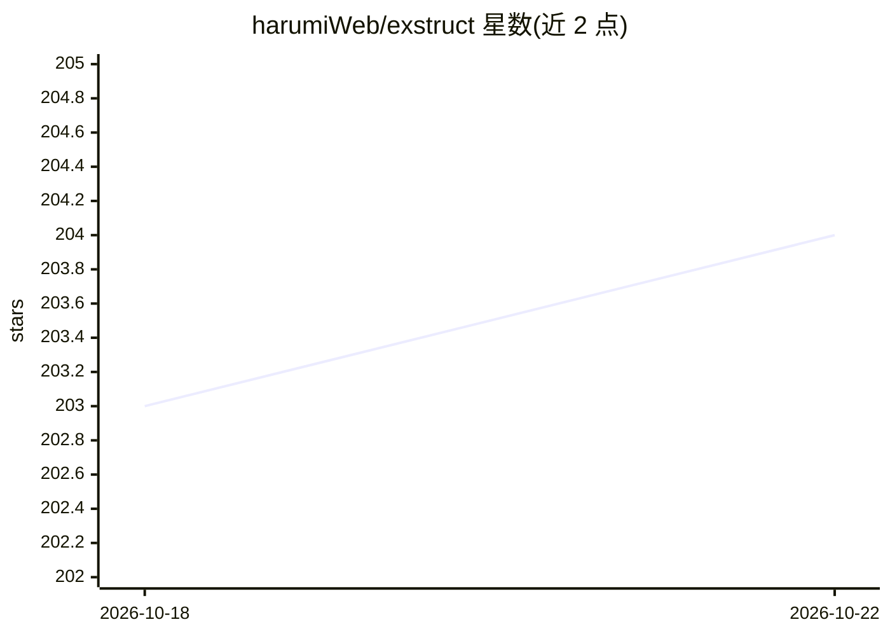

# harumiWeb/exstruct

⭐ 204 · Python · BSD-3-Clause · 推送 2026-10-04 · [GitHub](https://github.com/harumiWeb/exstruct) · [官网](https://harumiweb.github.io/exstruct/) · 个人维护

**Excel 转 JSON 的结构化提取与补丁式编辑工具，服务 LLM/RAG 流水线**

Python 库 + CLI + MCP 服务器三形态：将 Excel 工作簿读取为结构化 JSON（单元格、形状、图表、SmartArt、表格候选、合并区域、打印区、公式映射等），并提供基于 patch 契约的工作簿编辑（dry-run、校验、openpyxl/COM 后端）。多级输出模式适配环境：Windows COM 富提取、Linux/macOS 直接 OOXML 解析或 LibreOffice 运行时兜底。输出省略后端元数据以减少 token 用用，面向 LLM/RAG 预处理与 AI agent 的受控读写。

## 筛选速览

| 维度 | 判定 | 备注 |
|---|---|---|
| AI 角色 | `ai-ecosystem` | LLM/agent 周边工具 |
| 许可风险 | `permissive` | BSD-3-Clause |
| 部署形态 | `library` | 以包/库形式分发 |
| 模型依赖 | — | README 未给出锁定关系 |
| 硬件要求 | — | 无带数字的原话,不猜 |
| 安装摩擦 | `low` | 无编译、无系统依赖或容器化 |
| 成熟度 | — | 结构信号不足 |

## 能力要点

- Excel→结构化 JSON：单元格/形状/图表/SmartArt/表格候选/合并区域/打印区/公式映射
- MCP 服务器提供 9 个工具（提取、读写单元格、patch、校验等），支持路径限制与审批式执行
- 跨平台输出模式：COM 富提取 / 直接 OOXML / LibreOffice 兜底
- 附带 agent Skill（exstruct-cli）引导安全的 validate→dry-run→apply 编辑流程

## 适用场景

- 把含图表与形状的 Excel 转成 JSON 供 LLM/RAG 流水线使用
- 通过 MCP 让 AI agent 受控读写 Excel 工作簿
- 用 CLI 做 dry-run 可审的工作簿补丁编辑

## 场景标签

`文档解析` · 领域:知识与检索

## 证据(README 行号)

> L27: ExStruct reads Excel workbooks into structured data and applies patch-based
> L30: options tuned for LLM/RAG preprocessing, reviewable edit flows, and local
> L141: MCP is the integration / compatibility layer around the same editing core. Use

## 星数曲线

2026-10-18 203 → 2026-10-22 204（+1）

---
*卡片 v1 · prompt 1.4 · 生成 2026-10-22 · 置信度 mid · 依据 README sha `006e717ae26e` · [字段定义](../../DATASET.md)*
