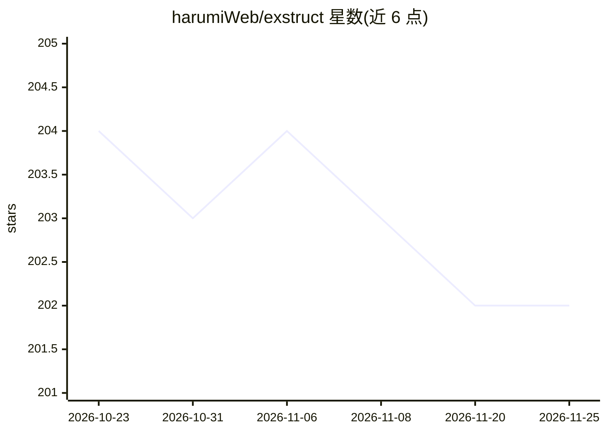

# harumiWeb/exstruct

⭐ 202 · Python · BSD-3-Clause · 推送 2026-11-17 · [GitHub](https://github.com/harumiWeb/exstruct) · [官网](https://harumiweb.github.io/exstruct/) · 个人维护

**为 LLM/RAG 流水线与 AI agent 提供读取和编辑 Excel 的 Python 工具**

ExStruct 将 Excel 工作簿读取为结构化 JSON，输出单元格、形状、图表、SmartArt、表格候选、合并区域、打印区域与公式映射，支持 JSON/YAML/TOON 输出与四种输出模式。它提供提取 API、基于 patch 的编辑 CLI，以及 stdio 方式的 MCP 服务器供宿主托管的 agent 集成，编辑流程遵循 validate→dry-run→inspect→apply 工作流。Windows COM 环境提取功能较完整；非 COM 的 Linux/macOS 下通过 OOXML 解析与可选 LibreOffice 运行时尽力提取。需要 Python 3.11.5 以上。

## 筛选速览

| 维度 | 判定 | 备注 |
|---|---|---|
| AI 角色 | `ai-native` | 本体是模型或模型工具 |
| 许可风险 | `permissive` | BSD-3-Clause |
| 部署形态 | `library` | 以包/库形式分发 |
| 模型依赖 | — | README 未给出锁定关系 |
| 硬件要求 | — | 无带数字的原话,不猜 |
| 安装摩擦 | `low` | 无编译、无系统依赖或容器化 |
| 成熟度 | — | 结构信号不足 |

## 能力要点

- Excel→结构化 JSON：单元格、形状、图表、SmartArt、表格候选、公式映射
- 三种提取后端：Windows Excel COM、直接 OOXML 解析、可选 LibreOffice 运行时
- JSON-first 编辑 CLI（patch/make/validate）与 dry-run 工作流
- MCP 服务器提供 9 个工具，含宿主管理的路径限制与审批执行

## 适用场景

- 为 LLM/RAG 流水线预处理 Excel 文档
- 让 AI agent 通过 MCP 服务器读写工作簿
- 以结构化 JSON 分析含表格与图表的报表

## 场景标签

`文档解析` · 领域:知识与检索

## 证据(README 行号)

> L27: ExStruct reads Excel workbooks into structured data and applies patch-based
> L29: JSON-first editing CLI, and an MCP server for host-managed integrations, with
> L43: - **Excel -> structured JSON**: outputs cells, shapes, charts, SmartArt, table candidates, merged-cell ranges, prin

## 星数曲线

2026-10-23 204 → 2026-11-25 202（-2）

---
*卡片 v1 · prompt 1.4 · 生成 2026-11-25 · 置信度 high · 依据 README sha `8bc115fc0da0` · [字段定义](../../DATASET.md)*
