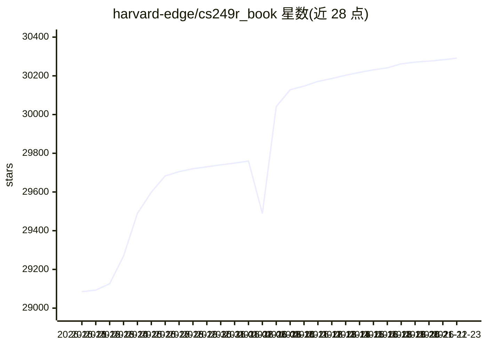

# harvard-edge/cs249r_book

⭐ 30,291 · Python · NOASSERTION · 推送 2026-11-22 · [GitHub](https://github.com/harvard-edge/cs249r_book) · [官网](https://mlsysbook.ai) · 组织维护

**哈佛 CS249r 机器学习系统开源教材系列（四卷）配套教学工具**

一套开源教科书与课程资源，覆盖从单机执行、分布式扩展到 Agentic AI 与物理 AI 的机器学习系统主题，共四卷；Vol I 已由 MIT Press 出版。仓库内含配套组件：TinyTorch（20 个模块从零构建 ML 框架）、MLSys·im 模拟器、硬件套件（Arduino/Seeed/Raspberry Pi）、Marimo 交互实验、StaffML 题库（9,000+ 题）、教学大纲与讲义幻灯片。Vol III/IV 为开放草稿，作者声明尚未定型、不建议引用。

## 筛选速览

| 维度 | 判定 | 备注 |
|---|---|---|
| AI 角色 | `ai-knowledge` | 知识聚合/清单类 |
| 许可风险 | `none` | NOASSERTION |
| 部署形态 | `None` |  |
| 模型依赖 | — | README 未给出锁定关系 |
| 硬件要求 | — | 无带数字的原话,不猜 |
| 安装摩擦 | `low` | 无编译、无系统依赖或容器化 |
| 成熟度 | `idea` | |

## 动量与使用信号

- 维护:`active` — 距上次 push 0.8 天,年发版 28,109 位贡献者
- 涨星:近 1 天 **+15**(自 20261016 起算)
- 平台:— · 协议:MCP

## 能力要点

- 四卷教材：单机系统、分布式扩展、Agentic、物理 AI
- TinyTorch：20 个渐进模块从零构建 ML 框架
- MLSys·im 模拟器建模内存/计算/网络/能耗限制
- StaffML 题库 9,000+ 系统设计题与讲师大纲

## 适用场景

- 自学机器学习系统的原理与实践
- 高校开设 ML 系统课程并使用配套大纲与实验
- 准备系统设计面试的工程师练习题库
- 在硬件设备上部署模型完成教学实验

## 场景标签

`教程课程` · 领域:学习与行业

## 证据(README 行号)

> L10:  An open textbook series on how machine learning systems are built and why they are built that way, with companion 
> L52: ## Why This Curriculum Exists

## 星数曲线

2026-10-21 29,085 → 2026-11-23 30,291（+1,206）

---
*卡片 v1 · prompt 1.4 · 生成 2026-11-23 · 置信度 high · 依据 README sha `ad52da29c319` · [字段定义](../../DATASET.md)*
