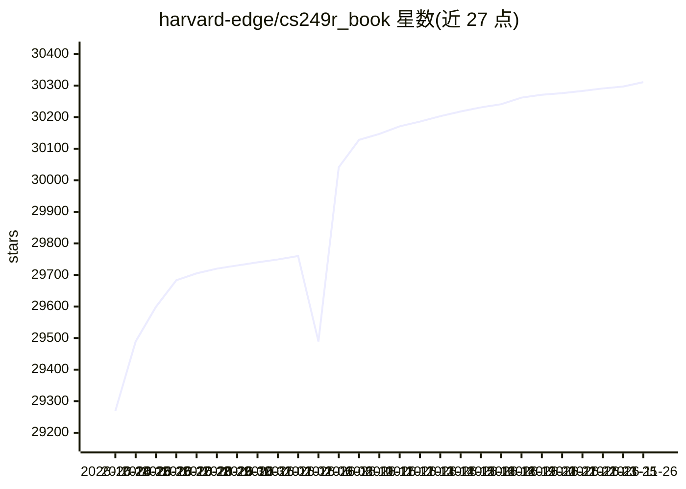

# harvard-edge/cs249r_book

⭐ 30,311 · Python · NOASSERTION · 推送 2026-11-25 · [GitHub](https://github.com/harvard-edge/cs249r_book) · [官网](https://mlsysbook.ai) · 组织维护

**哈佛 CS249r 机器学习系统开源教材（四卷）及配套工具课程包**

面向学生与教师的开放教材系列，讲解机器学习系统如何构建及其设计原理，覆盖单机执行、集群扩展、Agentic 系统与物理 AI 四卷。仓库同时提供配套组件：TinyTorch（20 个模块从零构建 ML 框架）、MLSys·im 模拟器、硬件套件（Arduino/Seeed/Grove/Raspberry Pi）、学习卡、9000+ 道系统设计题的 StaffML、讲师大纲与讲义。Vol I 由 MIT Press 出版，Vol III/IV 为开放草稿，README 提醒暂勿引用或用于教学。

## 筛选速览

| 维度 | 判定 | 备注 |
|---|---|---|
| AI 角色 | `ai-knowledge` | 知识聚合/清单类 |
| 许可风险 | `none` | NOASSERTION |
| 部署形态 | `None` |  |
| 模型依赖 | — | README 未给出锁定关系 |
| 硬件要求 | — | 无带数字的原话,不猜 |
| 安装摩擦 | `low` | 无编译、无系统依赖或容器化 |
| 成熟度 | `idea` | |

## 动量与使用信号

- 维护:`active` — 距上次 push 0.8 天,年发版 28,109 位贡献者
- 涨星:近 1 天 **+15**(自 20261016 起算)
- 平台:— · 协议:MCP

## 能力要点

- 四卷结构：单机系统、集群扩展、Agentic ML、物理 AI（后两卷开发中）
- TinyTorch：20 个渐进模块从张量到 transformer 构建 ML 框架
- MLSys·im 模拟器对内存、算力、网络与能耗限制建模
- StaffML 提供 9,000+ 道 cloud/edge/mobile/TinyML 系统设计题

## 适用场景

- 自学机器学习系统课程并配合 TinyTorch 动手实践
- 教师使用 Instructor Hub 的大纲、幻灯片与硬件套件开课
- 准备系统设计面试时用 StaffML 练习题训练
- 研究 AI 系统在能耗、内存与延迟约束下的架构权衡

## 场景标签

`教程课程` · 领域:学习与行业

## 证据(README 行号)

> L10:  An open textbook series on how machine learning systems are built and why they are built that way, with companion 
> L59: **AI engineering** is the discipline of building efficient, reliable, and safe intelligent systems that operate in 
> L141:  III. Agentic Machine Learning Systems

## 星数曲线

2026-10-24 29,269 → 2026-11-26 30,311（+1,042）

---
*卡片 v1 · prompt 1.4 · 生成 2026-11-26 · 置信度 high · 依据 README sha `0fb554203046` · [字段定义](../../DATASET.md)*
