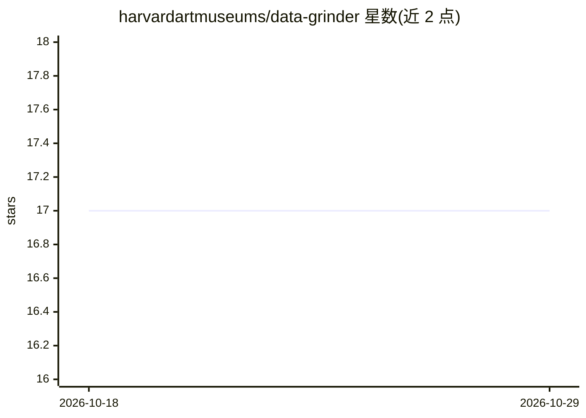

# harvardartmuseums/data-grinder

⭐ 17 · Python · 推送 2026-10-27 · [GitHub](https://github.com/harvardartmuseums/data-grinder) · 组织维护

**将图像并行送入多个第三方视觉/LLM 服务提取元数据的脚本与 API 服务**

哈佛艺术博物馆维护的 Python 脚本与 Flask 本地服务：输入 IIIF 兼容图像 URL，可选调用 HAM 颜色服务、哈希计算及 Clarifai、Imagga、Google Vision、Microsoft、AWS Rekognition 等视觉服务，加上 OpenAI/Anthropic/Google/Mistral/Qwen 等数十个 LLM 与视觉模型并行生成描述；ThreadPoolExecutor 并行调度，响应时间约等于最慢的单个模型。图像按尺寸分层缓存于本地或 S3。测试全部 mock 外部调用，无需凭据。

## 筛选速览

| 维度 | 判定 | 备注 |
|---|---|---|
| AI 角色 | `ai-native` | 本体是模型或模型工具 |
| 许可风险 | `none` | — |
| 部署形态 | `library` | 以包/库形式分发 |
| 模型依赖 | locked-api |  |
| 硬件要求 | — | 无带数字的原话,不猜 |
| 安装摩擦 | `low` | 无编译、无系统依赖或容器化 |
| 成熟度 | — | 结构信号不足 |

## 能力要点

- 单一请求并行调用多个视觉服务与 LLM，含请求预算与超时控制
- 图像分层缓存（本地目录或 S3 共享后端）
- 支持 40+ 个服务/模型，涵盖面孔、文本、颜色、标签与图像描述
- 单元测试全程 mock，外部 API 与 S3 调用不依赖凭据

## 适用场景

- 馆藏图像批量提取颜色、标签、面孔与描述元数据
- 同一图像对比多个 LLM/视觉模型的输出
- 作为本地 Flask 服务集成到图像处理流水线

## 场景标签

`图像视频处理` · 领域:感知与多模态

## 证据(README 行号)

> L3: A simple script and service for running an image through third party computer vision services that extract faces, te
> L75: ## Services Implemented
> L123: ## LLM Dispatch

## 星数曲线

2026-10-18 17 → 2026-10-29 17（+0）

---
*卡片 v1 · prompt 1.4 · 生成 2026-10-29 · 置信度 mid · 依据 README sha `89d30333a5dc` · [字段定义](../../DATASET.md)*
