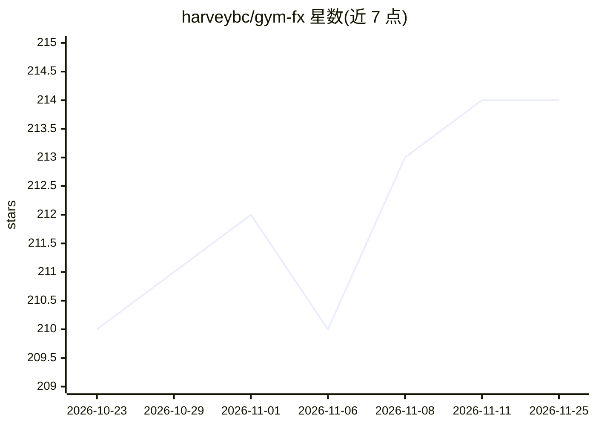

# harveybc/gym-fx

⭐ 214 · Python · 推送 2026-10-28 · [GitHub](https://github.com/harveybc/gym-fx) · 个人维护

**给强化学习智能体提供外汇与加密货币回测交易环境的 Gymnasium 库**

以 Gymnasium `gym.Env` 接口封装 backtrader 模拟，让 RL 智能体在历史行情上执行交易回测。关键机制包括：受保护 SL/TP 括号订单（插件缺失或失败时拒绝并计数，不静默降级）、两种偿付能力模式（保证金违约终止或训练用续期记账）、逐步与每回合诊断计数器、可脱离环境独立重建观测向量的 observation builder。数据源、经纪商、策略、预处理、奖励与指标均为 JSON 配置按名选择的插件。仅做模拟，无实盘下单路径；实验复现需固定版本与成本配置。

## 筛选速览

| 维度 | 判定 | 备注 |
|---|---|---|
| AI 角色 | `ai-native` | 本体是模型或模型工具 |
| 许可风险 | `none` | — |
| 部署形态 | `library` | 以包/库形式分发 |
| 模型依赖 | — | README 未给出锁定关系 |
| 硬件要求 | — | 无带数字的原话,不猜 |
| 安装摩擦 | `low` | 无编译、无系统依赖或容器化 |
| 成熟度 | — | 结构信号不足 |

## 能力要点

- 受保护 SL/TP 括号订单：插件失败时动作被拒绝并计数
- 偿付能力模式：normal_realistic / easy_chronological_continuation（仅训练）
- 全部组件为 JSON 配置选择的插件（数据源/经纪商/策略/奖励/指标）
- observation builder 可在无环境时按契约精确重建观测向量

## 适用场景

- 在历史外汇/加密行情上训练和评估强化学习交易智能体
- 需要受保护止损止盈与保证金记账的回测实验
- 在训练与评估之间复现完全一致的执行语义与诊断

## 场景标签

`金融量化` `强化学习` · 领域:学习与行业

## 证据(README 行号)

> L3: Gymnasium-compatible trading environment for FX and crypto time series. It
> L5: `gym.Env` step/reset interface so reinforcement-learning agents can trade a
> L47: **Role:** provide the trading *environment only* — observation construction,

## 星数曲线

2026-10-23 210 → 2026-11-25 214（+4）

---
*卡片 v1 · prompt 1.4 · 生成 2026-11-25 · 置信度 high · 依据 README sha `bff90611bb86` · [字段定义](../../DATASET.md)*
