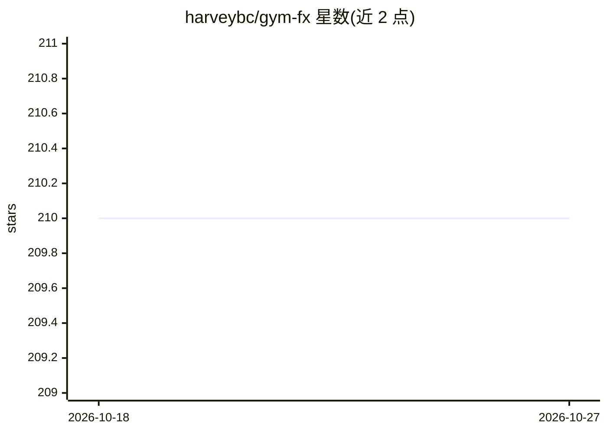

# harveybc/gym-fx

⭐ 210 · Python · 推送 2026-10-22 · [GitHub](https://github.com/harveybc/gym-fx) · 个人维护

**面向 FX/加密货币的 Gymnasium 交易模拟环境，供 RL 训练**

将 backtrader 模拟封装为标准 gym.Env 的交易环境库：提供真实化订单执行、受保护的止损/止盈括号单、保证金与偿付能力记账、执行成本模型和会话/事件上下文，供强化学习智能体在历史行情上交易。数据源、经纪商、策略、预处理器、奖励与指标均为按名称从 JSON 配置选择的插件。定位仅为环境层，不含训练、预测和实盘下单；默认离线 CSV 模拟，无需网络与凭证。通过源码 editable 安装，附带 84 项测试与可复现的回合诊断输出。

## 筛选速览

| 维度 | 判定 | 备注 |
|---|---|---|
| AI 角色 | `ai-ecosystem` | LLM/agent 周边工具 |
| 许可风险 | `none` | — |
| 部署形态 | `library` | 以包/库形式分发 |
| 模型依赖 | — | README 未给出锁定关系 |
| 硬件要求 | — | 无带数字的原话,不猜 |
| 安装摩擦 | `low` | 无编译、无系统依赖或容器化 |
| 成熟度 | — | 结构信号不足 |

## 能力要点

- backtrader 封装为 Gymnasium step/reset 接口（GymFxEnv）
- 受保护 SL/TP 执行：插件未实现括号单时入场被拒绝并计数，不静默降级
- 两种偿付能力模式：normal_realistic 与仅训练用的 easy_chronological_continuation
- 回合级 action_diagnostics / execution_diagnostics 审计输出与回写完整配置以便复现

## 适用场景

- 为 SAC/PPO/DQN 等 RL 智能体提供外汇/加密货币回测交易环境
- 在保证金强平与执行成本约束下研究智能体偿付能力课程
- 生成带执行诊断的证据链以复现实验结果

## 场景标签

`金融量化` `强化学习` · 领域:学习与行业

## 证据(README 行号)

> L3: Gymnasium-compatible trading environment for FX and crypto time series. It
> L5: `gym.Env` step/reset interface so reinforcement-learning agents can trade a
> L27: **Lifecycle: ACTIVE-CORE.** This environment is the execution layer consumed by

## 星数曲线

2026-10-18 210 → 2026-10-27 210（+0）

---
*卡片 v1 · prompt 1.4 · 生成 2026-10-22 · 置信度 mid · 依据 README sha `ad8ed5fd3b73` · [字段定义](../../DATASET.md)*
