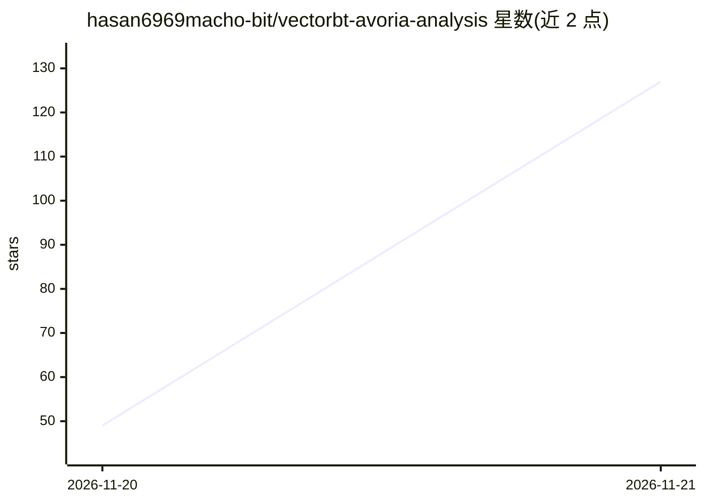

# hasan6969macho-bit/vectorbt-avoria-analysis

⭐ 127 · TypeScript · MIT · 推送 2026-11-20 · [GitHub](https://github.com/hasan6969macho-bit/vectorbt-avoria-analysis) · 个人维护

**基于 vectorbt 的量化回测与参数扫描工具库**

面向量化开发者与研究员的 Python 回测工具库，构建于 vectorbt 的 Portfolio 与 IndicatorFactory 之上。将策略定义、信号生成、参数扫描、组合模拟、指标计算与可视化组织为独立模块，输入接受 pandas/NumPy 的 OHLCV 数据；提供 Sharpe、Sortino、最大回撤等指标，强调无全局状态、确定性输出与类型标注。要求 Windows 10/11 与 PowerShell 5.1+，通过 PowerShell 脚本安装。

## 筛选速览

| 维度 | 判定 | 备注 |
|---|---|---|
| AI 角色 | `ai-enhanced` | 去掉 AI 部分产品仍成立 |
| 许可风险 | `permissive` | MIT |
| 部署形态 | `None` |  |
| 模型依赖 | — | README 未给出锁定关系 |
| 硬件要求 | — | 无带数字的原话,不猜 |
| 安装摩擦 | `low` | 无编译、无系统依赖或容器化 |
| 成熟度 | — | 结构信号不足 |

## 能力要点

- 基于 vectorbt 的向量化回测核心，全序列数组运算、无逐 bar Python 循环
- 网格/区间参数扫描，一次遍历返回索引化结果帧
- 显式种子与稳定排序，保证相同输入产生相同结果
- 策略定义、扫描、组合回测、信号检查、报告与可视化的模块化分层

## 适用场景

- 对动量入场策略按回看窗口与阈值做参数扫描
- 用同一规则集评估多资产组合的配置与再平衡方式
- 检查信号与指标输出以调试策略中的意外平仓

## 场景标签

`金融量化` · 领域:学习与行业

## 证据(README 行号)

> L12: A vectorbt-based toolkit for running Avoria-style backtests and parameter sweeps over OHLCV data, built to keep str
> L23: - **Vectorized backtesting core** — signal generation, portfolio simulation, and metric computation execute as arra

## 星数曲线

2026-11-20 49 → 2026-11-21 127（+78）

---
*卡片 v1 · prompt 1.4 · 生成 2026-11-20 · 置信度 low · 依据 README sha `acacfd771427` · [字段定义](../../DATASET.md)*
