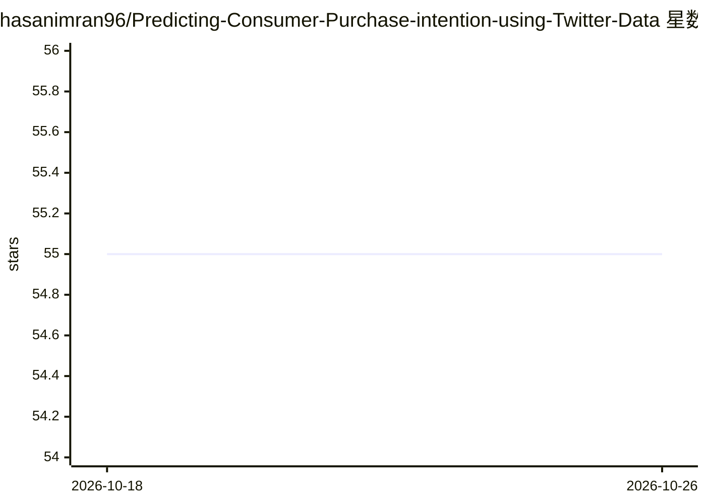

# hasanimran96/Predicting-Consumer-Purchase-intention-using-Twitter-Data

⭐ 55 · Jupyter Notebook · MIT · 推送 2026-07-26 · [GitHub](https://github.com/hasanimran96/Predicting-Consumer-Purchase-intention-using-Twitter-Data) · 个人维护

**毕业设计：用推特数据与机器学习预测用户购买意向**

最终学年项目仓库：通过 Twitter Search API 抓取推文并人工标注为有/无购买意向，经文本清洗与特征提取后训练 SVM、朴素贝叶斯、逻辑回归、决策树、神经网络五类分类器，输出按购买意向排序的用户列表。附带 Django 网站用于汇总结果并支持用户上传自有数据训练/测试预构建模型；仓库还含海报、报告与演示文稿。依赖 pip 安装，运行于 Windows 命令行的虚拟环境。

## 筛选速览

| 维度 | 判定 | 备注 |
|---|---|---|
| AI 角色 | `ai-native` | 本体是模型或模型工具 |
| 许可风险 | `permissive` | MIT |
| 部署形态 | `library` | 以包/库形式分发 |
| 模型依赖 | — | README 未给出锁定关系 |
| 硬件要求 | — | 无带数字的原话,不猜 |
| 安装摩擦 | `low` | 无编译、无系统依赖或容器化 |
| 成熟度 | — | 结构信号不足 |

## 能力要点

- 推文标注 PI/No PI 并训练 5 种分类器
- Django 网站支持上传自有数据集训练/测试模型
- 提供 TweetClaw 导出数据转 class,text 格式的脚本
- 仓库附带报告、海报与证书等项目材料

## 适用场景

- 分析推特用户对产品的购买意向
- 上传自有数据集复用预构建分类模型训练与测试
- 作为文本分类毕业设计的参考实现

## 场景标签

 · 领域:机器学习/社交媒体分析

## 证据(README 行号)

> L7: This project leverages **Twitter data** and **machine learning** to predict whether a user has **purchase intention 
> L15: 5. 🤖 **Machine Learning Models** — Train and evaluate multiple classifiers:

## 星数曲线

2026-10-18 55 → 2026-10-26 55（+0）

---
*卡片 v1 · prompt 1.4 · 生成 2026-10-24 · 置信度 mid · 依据 README sha `089f4adf2d59` · [字段定义](../../DATASET.md)*
