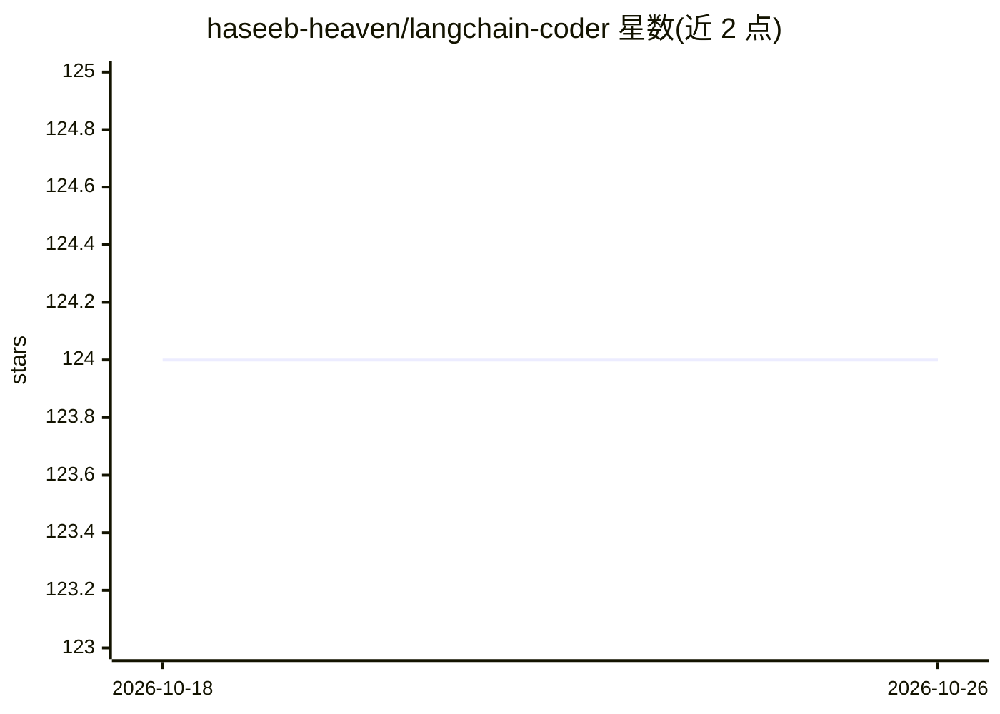

# haseeb-heaven/langchain-coder

⭐ 124 · Python · MIT · 推送 2026-10-25 · [GitHub](https://github.com/haseeb-heaven/langchain-coder) · [官网](https://langchain-coder.streamlit.app) · 个人维护

**面向开发者的 Web 代码生成工具：接多家 LLM 生成并执行代码**

基于 Streamlit 的 Web 应用：用户输入提示词并选择编程语言，调用 OpenAI（GPT-3.5/3.5 Turbo/GPT-4）或 Google（Vertex AI Code Gecko/Code Bison、PALM、Gemini）模型生成代码，内置可定制代码编辑器，支持保存与离线/在线（JDoodle API，70+ 语言）执行代码，并提供代码调试器与编码规范选项（模块化、异常处理、日志等）。使用需自行配置 OpenAI API Key 或 Google 服务账号凭证；PALM 为 Google 已弃用的旧模型，README 仍保留其接入说明。

## 筛选速览

| 维度 | 判定 | 备注 |
|---|---|---|
| AI 角色 | `ai-native` | 本体是模型或模型工具 |
| 许可风险 | `permissive` | MIT |
| 部署形态 | `None` |  |
| 模型依赖 | locked-api |  |
| 硬件要求 | — | 无带数字的原话,不猜 |
| 安装摩擦 | `low` | 无编译、无系统依赖或容器化 |
| 成熟度 | — | 结构信号不足 |

## 能力要点

- 接入 OpenAI 与 Google（Vertex AI/PALM/Gemini）模型生成与补全代码
- 离线与在线（JDoodle，70+ 语言）两种代码执行模式
- 内置代码调试器与 10 项编码规范选项
- 可调节温度、最大 token、模型、项目/区域与凭证等设置

## 适用场景

- 我想用自然语言提示快速生成多种编程语言的代码片段
- 我希望生成后直接在应用内执行和调试代码
- 我想按编码规范（异常处理、日志等）约束生成结果

## 场景标签

`代码生成` · 领域:编码与开发

## 证据(README 行号)

> L20: LangChain Coder AI is a state-of-the-art code generation tool powered by OpenAI and Vertex AI. It provides a seamle
> L25: - **AI-Powered Code Generation and Completion**: Utilizes OpenAI and Vertex AI models for efficient and accurate co

## 星数曲线

2026-10-18 124 → 2026-10-26 124（+0）

---
*卡片 v1 · prompt 1.4 · 生成 2026-10-23 · 置信度 high · 依据 README sha `400b56568e7c` · [字段定义](../../DATASET.md)*
