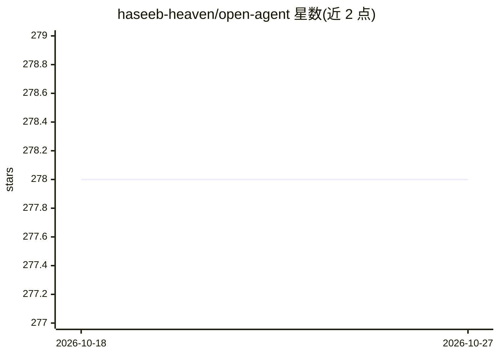

# haseeb-heaven/open-agent

⭐ 278 · TypeScript · Apache-2.0 · 推送 2026-10-06 · [GitHub](https://github.com/haseeb-heaven/open-agent) · [官网](https://www.npmjs.com/package/@haseeb_heaven/open-agent) · 个人维护

**终端里的开源 AI agent：自然语言下任务，多模型本地/云端执行**

基于 Gemini CLI 的 Apache-2.0 fork，面向终端用户的 AI agent：用自然语言描述任务，由 agent 规划并调用工具（如分析 CSV 并绘图）。模型接入支持本地 Ollama / LM Studio（无需 key）与 OpenRouter、OpenAI、Anthropic、Gemini 等 11 家云端供应商（BYOK，一供应商一环境变量），并提供免费模型轮换与自动回退。内置多后端 Web 搜索（Exa/DuckDuckGo 无 key 可用）、扩展安装（兼容 Claude .claude-plugin 与 MCP 清单）。需 Node.js 22+，npm 全局安装或从源码构建。

## 筛选速览

| 维度 | 判定 | 备注 |
|---|---|---|
| AI 角色 | `ai-native` | 本体是模型或模型工具 |
| 许可风险 | `permissive` | Apache-2.0 |
| 部署形态 | `library` | 以包/库形式分发 |
| 模型依赖 | local-ok | 支持本地模型 |
| 硬件要求 | — | 无带数字的原话,不猜 |
| 安装摩擦 | `low` | 无编译、无系统依赖或容器化 |
| 成熟度 | — | 结构信号不足 |

## 能力要点

- 本地 Ollama / LM Studio 无 key 运行，云端 11 家供应商 BYOK 接入
- 免费模型轮换与自动回退（--free）
- 多后端 Web 搜索：Exa、DuckDuckGo 无 key 可用，另有 Brave/Tavily 等
- 支持 Claude .claude-plugin 与 .mcp.json 扩展清单安装

## 适用场景

- 在终端用自然语言让 agent 分析数据并出结果
- 本地模型离线跑 agent 任务，不上传 key
- 把多家云端模型按 key 接入同一终端工作流

## 场景标签

`AI 助手` `数据分析` `模型网关` · 领域:Agent 开发

## 证据(README 行号)

> L12: > Describe a task in plain English. OpenAgent plans, uses tools, and delivers —
> L24: **Free** OpenRouter models · **local** Ollama / LM Studio · **Windows / Mac /

## 星数曲线

2026-10-18 278 → 2026-10-27 278（+0）

---
*卡片 v1 · prompt 1.4 · 生成 2026-10-22 · 置信度 high · 依据 README sha `d464ba5ec668` · [字段定义](../../DATASET.md)*
