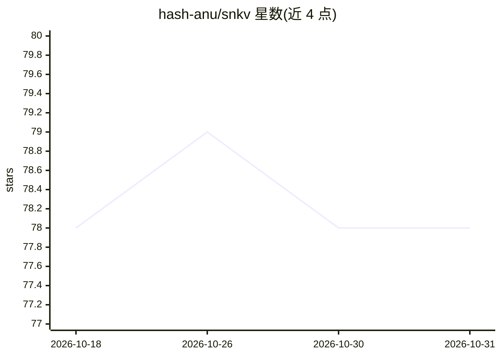

# hash-anu/snkv

⭐ 78 · C · Apache-2.0 · 推送 2026-10-25 · [GitHub](https://github.com/hash-anu/snkv) · [官网](https://hash-anu.github.io/snkv/) · 个人维护

**C 编写的嵌入式 ACID 键值存储，可选 HNSW 向量检索**

SNKV 是单头文件嵌入式键值存储库，直接调用 SQLite 的 B-tree 存储引擎而跳过 SQL 层（无解析器、查询规划器与 VM）。提供 ACID 事务、WAL 模式、原生 TTL、XChaCha20-Poly1305 加密（Argon2id 派生）、column families、迭代器与线程安全 API；可选构建（make vector，需 g++）集成 usearch 提供 HNSW 向量索引，存于同一 .db 文件。README 附与 SQLite/LMDB/RocksDB 的基准数据。Python 绑定已停止在 master 维护，需切换分支。

## 筛选速览

| 维度 | 判定 | 备注 |
|---|---|---|
| AI 角色 | `ai-enhanced` | 去掉 AI 部分产品仍成立 |
| 许可风险 | `permissive` | Apache-2.0 |
| 部署形态 | `desktop` | 安装包/桌面程序 |
| 模型依赖 | — | README 未给出锁定关系 |
| 硬件要求 | — | 无带数字的原话,不猜 |
| 安装摩擦 | `medium` | 含编译或系统依赖之一 |
| 成熟度 | — | 结构信号不足 |

## 能力要点

- 直接使用 SQLite B-tree 存储引擎、跳过 SQL 层的 KV API
- ACID 事务、WAL 模式、原生 TTL（惰性过期）
- XChaCha20-Poly1305 加密与 Argon2id 密钥派生，API 透明
- 可选 usearch HNSW 向量索引（make vector，需 g++）

## 适用场景

- 在 C 项目中嵌入一个读多写少、支持 TTL 的键值存储
- 会话、缓存、租约等带过期语义的数据存储
- 需要在同一数据库文件内做向量检索的嵌入式场景

## 场景标签

`向量数据库` · 领域:知识与检索

## 证据(README 行号)

> L12: **SNKV** is a lightweight, ACID-compliant embedded key-value store written in C. It talks directly to SQLite's B-tr
> L43: - **Vector search**: HNSW index via usearch (`make vector`), stored in the same `.db` file. See examples/vector.c.

## 星数曲线

2026-10-18 78 → 2026-10-31 78（+0）

---
*卡片 v1 · prompt 1.4 · 生成 2026-10-24 · 置信度 mid · 依据 README sha `11b75f95aef1` · [字段定义](../../DATASET.md)*
