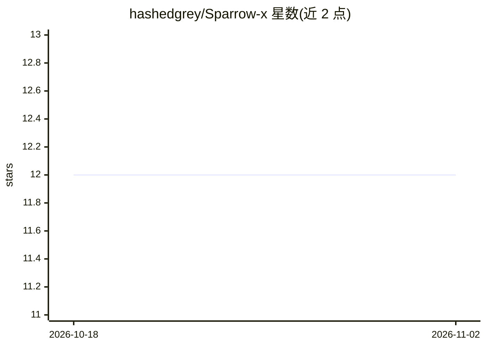

# hashedgrey/Sparrow-x

⭐ 12 · Java · MIT · 推送 2026-10-31 · [GitHub](https://github.com/hashedgrey/Sparrow-x) · 个人维护

**面向工程组织的内部知识问答与 agent 调查平台**

SparrowX 是面向工程组织的内部知识与 agent 调查平台，从公司文档与组织数据中生成带引用证据的回答。由三个 Spring Boot 服务（Agentic/Internal/Document）组成：System 1 用 Glide/Jev 做有界语义决策（意图分类、FAST/RESEARCH 路径选择），System 2 用 Embabel 的 GOAP/HYBRID 规划执行目标导向任务，Temporal 负责任务持久化与重试。基础设施（PostgreSQL、Neo4j、Qdrant、Elasticsearch、MinIO 等）通过 Docker Compose 运行，Java 服务本地 Maven 构建运行。限制：需 JDK 25、完整栈内存占用高、默认配置仅适用于隔离的本地开发环境。

## 筛选速览

| 维度 | 判定 | 备注 |
|---|---|---|
| AI 角色 | `ai-native` | 本体是模型或模型工具 |
| 许可风险 | `permissive` | MIT |
| 部署形态 | `self-host` | docker 或自建部署 |
| 模型依赖 | — | README 未给出锁定关系 |
| 硬件要求 | — | 无带数字的原话,不猜 |
| 安装摩擦 | `low` | 无编译、无系统依赖或容器化 |
| 成熟度 | — | 结构信号不足 |

## 能力要点

- System 1（Glide/Jev 有界决策）与 System 2（Embabel GOAP/HYBRID 规划）分离的决策架构
- 回答带引用证据与可审计的 agent 执行轨迹（SSE 流式输出 mission/progress/trace 事件）
- Temporal 持久化任务：检查点、重试、审批与取消
- 未命中的来源保留为显式证据缺口，不推断为事实

## 适用场景

- 查询服务负责人、团队、架构文档与 runbook 等内部知识
- 基于事件报告做带引用的安全调查与整改步骤梳理
- 对比部署实践与公司标准，生成带证据的运营风险评估
- 审计 agent 的决策过程与模型使用记录

## 场景标签

`文档问答` · 领域:知识与检索

## 证据(README 行号)

> L6: **SparrowX** is an internal knowledge and agentic investigation platform for engineering organizations. It combines 
> L24: |**Agentic Service** (`agenticsvc`)|Mission submission, intent classification, bounded decisions, Embabel planning,
> L55: Embabel executes registered actions using **GOAP** or **HYBRID** planning, with dynamic action eligibility and valu

## 星数曲线

2026-10-18 12 → 2026-11-02 12（+0）

---
*卡片 v1 · prompt 1.4 · 生成 2026-11-01 · 置信度 high · 依据 README sha `45f24c8311f3` · [字段定义](../../DATASET.md)*
