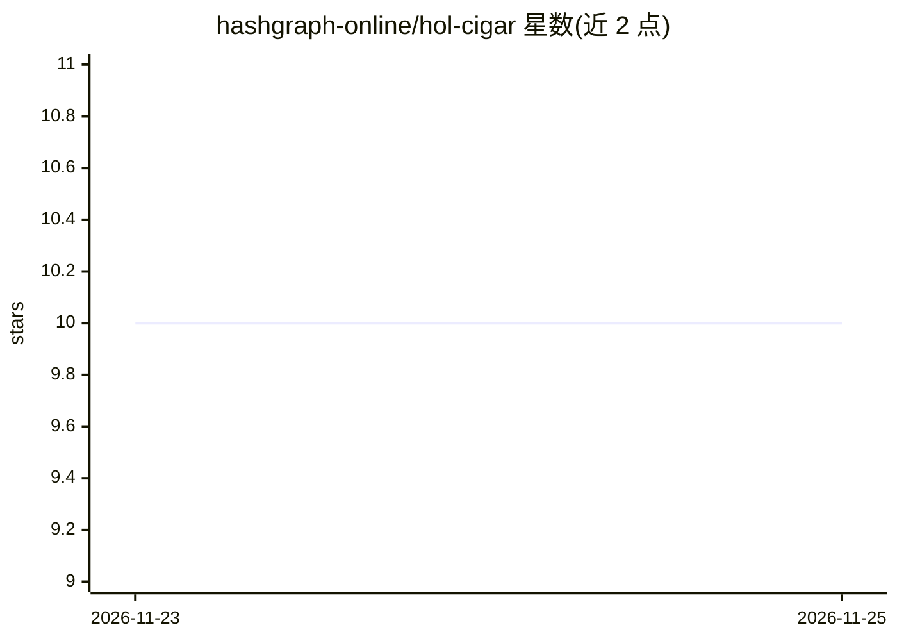

# hashgraph-online/hol-cigar

⭐ 10 · Rust · Apache-2.0 · 推送 2026-11-20 · [GitHub](https://github.com/hashgraph-online/hol-cigar) · [官网](https://hol.org/cigar) · 组织维护

**面向 AI agent 的上下文工程协议与运行时：受限检索+引用+审计**

CIGAR（Context Intelligence Graph Agentic Runtime）由 HOL 开发，是开源上下文工程协议与运行时：从用户提供的文件系统/Git 源构建本地上下文图，按词法索引编译出带引用、精确 token 预算的上下文包，并记录来源与证据以支持回答审查、两 agent 交接、外部操作效果恢复与无出网重放。本地上下文图无需服务器、账户、API key、守护进程或数据库。提供 Rust/Python/TypeScript SDK、CLI、本地 daemon、MCP server 与 Claude Code 适配器。README 标明为 alpha 软件，生产资质为 False。

## 筛选速览

| 维度 | 判定 | 备注 |
|---|---|---|
| AI 角色 | `ai-ecosystem` | LLM/agent 周边工具 |
| 许可风险 | `permissive` | Apache-2.0 |
| 部署形态 | `library` | 以包/库形式分发 |
| 模型依赖 | — | README 未给出锁定关系 |
| 硬件要求 | — | 无带数字的原话,不猜 |
| 安装摩擦 | `low` | 无编译、无系统依赖或容器化 |
| 成熟度 | `idea` | |

## 能力要点

- 编译带引用、精确 token 预算的确定性上下文包
- 无需服务器/账户/API key/数据库的本地上下文图
- 回答审查、签名交接、可恢复外部效果与无出网重放
- 提供 MCP server、Claude Code 适配器与三种语言 SDK

## 适用场景

- 为多 agent 系统控制在精确 token 预算内分发带出处的上下文
- 对 agent 读取内容与决策依据进行审计和重放
- 以 MCP server 形式接入 Claude Code 等工作流

## 场景标签

`Agent 记忆` · 领域:Agent 开发

## 证据(README 行号)

> L14: |HOL whole dark logo|**Give AI agents the right context, with citations, inside an exact token budget.** CIGAR (Con
> L95: |Agent integration|Use the CLI, embedded runtime, local daemon, MCP server, Claude Code adapter, or the Rust, Pytho
> L139: CIGAR is model-agnostic. It is not a model, hosted agent service, autonomous scheduler, or

## 星数曲线

2026-11-23 10 → 2026-11-25 10（+0）

---
*卡片 v1 · prompt 1.4 · 生成 2026-11-23 · 置信度 high · 依据 README sha `79625f2f8f12` · [字段定义](../../DATASET.md)*
