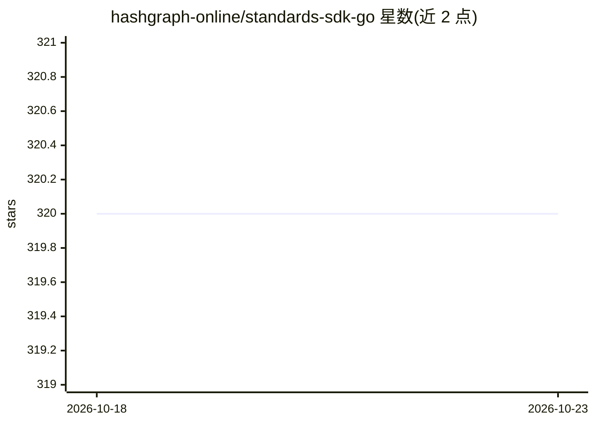

# hashgraph-online/standards-sdk-go

⭐ 320 · Go · Apache-2.0 · 推送 2026-04-10 · [GitHub](https://github.com/hashgraph-online/standards-sdk-go) · [官网](https://hol.org) · 组织维护

**Go 实现的 Hiero 共识规范（HCS）官方 SDK**

面向 Go 开发者的区块链 SDK，提供 HCS-2 到 HCS-27 等多个标准规范的实现包，覆盖注册表创建、NFT 铸造、agent 档案与发现、连接消息、状态哈希、检查点等交易构建与镜像节点读取能力；另含 Inscriber 与 Registry Broker 高层客户端（websocket 铭刻、报价、技能铭刻、搜索验证等）。通过 go get 安装，凭环境变量配置 Hedera 账户，支持 .env 自动加载与 live 集成测试。

## 筛选速览

| 维度 | 判定 | 备注 |
|---|---|---|
| AI 角色 | `ai-ecosystem` | LLM/agent 周边工具 |
| 许可风险 | `permissive` | Apache-2.0 |
| 部署形态 | `None` |  |
| 模型依赖 | — | README 未给出锁定关系 |
| 硬件要求 | — | 无带数字的原话,不猜 |
| 安装摩擦 | `low` | 无编译、无系统依赖或容器化 |
| 成熟度 | — | 结构信号不足 |

## 能力要点

- 覆盖 HCS-2 至 HCS-27 十余个规范包的交易构建与读取
- Inscriber 客户端支持 websocket 铭刻、报价与批量文件
- Registry Broker 客户端覆盖搜索、验证、技能铭刻与端到端加密聊天
- 自动加载 .env 凭据并支持网络级环境变量覆盖

## 适用场景

- 在 Go 项目中构建与 Hedera 共识服务的标准交易
- 实现去中心化注册表与 agent 档案/发现逻辑
- 通过 Inscriber 完成链上铭刻与报价流程

## 场景标签

 · 领域:区块链/分布式账本

## 证据(README 行号)

> L13: ||Go reference implementation of the Hiero Consensus Specifications (HCS) and Registry Broker utilities. 📚 Standard
> L45: - HCS-11 build agent profile

## 星数曲线

2026-10-18 320 → 2026-10-23 320（+0）

---
*卡片 v1 · prompt 1.4 · 生成 2026-10-21 · 置信度 mid · 依据 README sha `94bd40cea703` · [字段定义](../../DATASET.md)*
