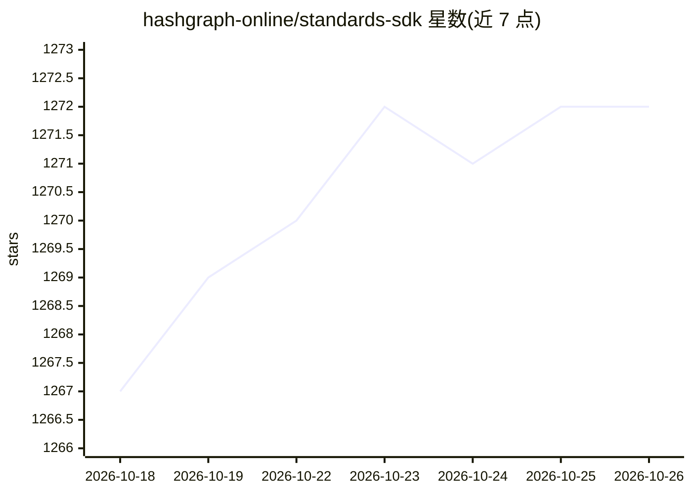

# hashgraph-online/standards-sdk

⭐ 1,272 · TypeScript · Apache-2.0 · 推送 2026-10-19 · [GitHub](https://github.com/hashgraph-online/standards-sdk) · [官网](https://hol.org) · 组织维护

**Hedera HCS 标准的官方 TypeScript SDK：实现文件、注册与代理通信标准**

HOL 维护的 Hashgraph 共识标准（HCS）参考实现 SDK，覆盖 HCS-1 文件存储、HCS-2 注册索引、HCS-10 代理间可信点对点通信、HCS-11 去中心化身份等 8 项标准。面向在 Hedera 上构建 AI 代理应用的开发者：提供 RegistryBrokerClient 做技能验证与 DNS TXT 域名证明，附交互式 CLI 与多个可运行 demo（代理注册、连接建立、大消息递归存储、断点续传创建代理）。运行 demo 需配置 Hedera 账号凭证环境变量。

## 筛选速览

| 维度 | 判定 | 备注 |
|---|---|---|
| AI 角色 | `ai-ecosystem` | LLM/agent 周边工具 |
| 许可风险 | `permissive` | Apache-2.0 |
| 部署形态 | `library` | 以包/库形式分发 |
| 模型依赖 | — | README 未给出锁定关系 |
| 硬件要求 | — | 无带数字的原话,不猜 |
| 安装摩擦 | `low` | 无编译、无系统依赖或容器化 |
| 成熟度 | — | 结构信号不足 |

## 能力要点

- 实现 HCS-1/2/3/7/10/11/20/27 八项 HCS 标准
- RegistryBrokerClient 支持技能验证与 DNS TXT 域名/UAID 证明
- 代理创建中断后可凭 .env 状态断点续传
- 内置交互式 CLI 与 registry broker、HCS-10 等 demo

## 适用场景

- 在 Hedera 上构建遵循 HCS 标准的去中心化 AI 代理
- 做代理技能的版本验证与域名归属证明
- 运行 demo 学习 HCS-10 代理间点对点通信流程

## 场景标签

`Agent 框架` · 领域:Agent 开发

## 证据(README 行号)

> L3: ||A lightweight SDK providing reference implementations for Hashgraph Consensus Standards (HCS) created by HOL. This
> L104: |`HCS-10`|Trustless Peer-to-Peer Communication for Agents and AI|

## 星数曲线

2026-10-18 1,267 → 2026-10-26 1,272（+5）

---
*卡片 v1 · prompt 1.4 · 生成 2026-10-21 · 置信度 high · 依据 README sha `2445ab02cfb2` · [字段定义](../../DATASET.md)*
