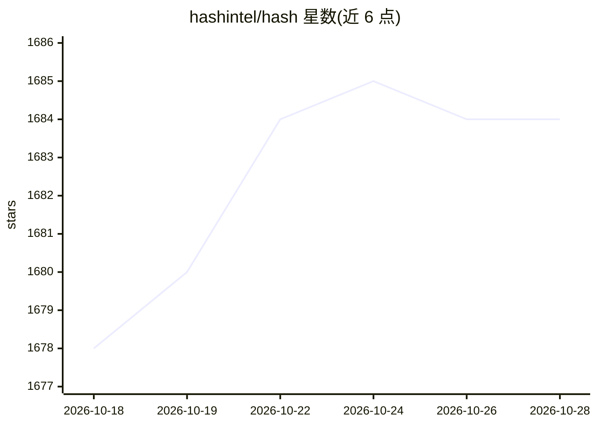

# hashintel/hash

⭐ 1,684 · TypeScript · NOASSERTION · 推送 2026-10-27 · [GitHub](https://github.com/hashintel/hash) · [官网](https://hash.dev) · 组织维护

**开源多租户知识图谱数据库与仿真平台，自助构建图数据**

HASH 是一个开源多租户平台，将原始信息转为知识图与流程图，构建支撑自动化、决策与 AI 的图背世界模型；数据库可持续增长、自校验，支持双时态（bitemporality）记录与查询。自主 agent 可从公网与私有来源采集并结构化信息；非技术用户可可视化浏览实体与类型。提供托管版 hash.ai、本地运行（Docker Compose 基础设施 + Rust 编译的图层）与自托管云部署三种方式，可选跳过本地 Rust 编译改用 Docker 运行图服务。

## 筛选速览

| 维度 | 判定 | 备注 |
|---|---|---|
| AI 角色 | `ai-enhanced` | 去掉 AI 部分产品仍成立 |
| 许可风险 | `none` | NOASSERTION |
| 部署形态 | `self-host` | docker 或自建部署 |
| 模型依赖 | — | README 未给出锁定关系 |
| 硬件要求 | — | 无带数字的原话,不猜 |
| 安装摩擦 | `low` | 无编译、无系统依赖或容器化 |
| 成熟度 | — | 结构信号不足 |

## 能力要点

- 自助构建知识图与流程图，数据库自动增长、结构化并校验自身
- 双时态（bitemporality）一阶支持记录与查询事件发生时间与知晓时间
- 自主 agent 从公网及私有来源采集并结构化信息
- 可视化浏览与管理实体（数据）与类型（schema），非技术用户可用

## 适用场景

- 把多来源数据整合为图结构的知识库作为可信数据源
- 流程建模、优化与决策支持
- 自托管部署知识图谱平台用于团队/多租户场景

## 场景标签

`知识图谱` · 领域:知识与检索

## 证据(README 行号)

> L11: **HASH supports turning raw information into knowledge and process graphs, helping create graph-backed _world model
> L13: Many of HASH's features are unique to a platform of its kind, including its support for bitemporality, which provid

## 星数曲线

2026-10-18 1,678 → 2026-10-28 1,684（+6）

---
*卡片 v1 · prompt 1.4 · 生成 2026-10-21 · 置信度 high · 依据 README sha `bea0985fa84f` · [字段定义](../../DATASET.md)*
