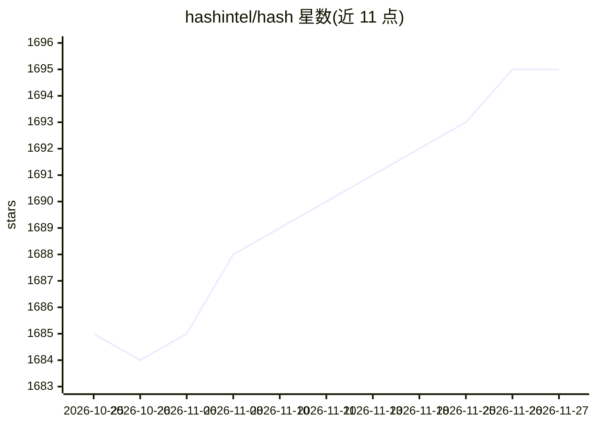

# hashintel/hash

⭐ 1,695 · TypeScript · NOASSERTION · 推送 2026-11-26 · [GitHub](https://github.com/hashintel/hash) · [官网](https://hash.dev) · 组织维护

**自助构建知识图谱与仿真的多租户开源数据库平台**

HASH 是一个公开 monorepo，包含自建知识图谱平台的应用代码、文档与基础设施。平台将原始信息整合为实体与类型（schema）构成的知识图谱，支持双时态记录与查询（事件发生时间与获知时间分开记录），可部署自主 agent 从公共互联网和私有数据源采集、校验、维护数据。非技术用户可通过可视化界面浏览管理实体与类型。本地运行需 Docker、mise 工具链与 Rust 编译（或用容器镜像跳过编译）；亦可使用 hash.ai 托管服务或自托管部署。

## 筛选速览

| 维度 | 判定 | 备注 |
|---|---|---|
| AI 角色 | `ai-ecosystem` | LLM/agent 周边工具 |
| 许可风险 | `none` | NOASSERTION |
| 部署形态 | `self-host` | docker 或自建部署 |
| 模型依赖 | — | README 未给出锁定关系 |
| 硬件要求 | — | 无带数字的原话,不猜 |
| 安装摩擦 | `low` | 无编译、无系统依赖或容器化 |
| 成熟度 | — | 结构信号不足 |

## 能力要点

- 自助生长、自校验的知识图谱数据库，支持双时态记录与查询
- 可部署自主 agent 从公共互联网与私有数据源采集并结构化信息
- 非技术用户可可视化浏览与管理实体（数据）与类型（schema）
- AI 功能通过 OpenAI/Anthropic API key 接入，默认值即可运行非 AI 部分

## 适用场景

- 为流程自动化与决策支持构建可校验的知识图谱
- 整合公共互联网与私有数据源形成标准化语义数据
- 为关键数据提供单一事实来源与决策平台
- 自托管部署完整的图谱+API+前端+工作流栈

## 场景标签

`知识图谱` · 领域:知识与检索

## 证据(README 行号)

> L11: **HASH supports turning raw information into knowledge and process graphs, helping create graph-backed _world model
> L17: Instructions for using HASH can be found in the HASH Developer Docs.

## 星数曲线

2026-10-25 1,685 → 2026-11-27 1,695（+10）

---
*卡片 v1 · prompt 1.4 · 生成 2026-11-23 · 置信度 high · 依据 README sha `acdd53bfa89e` · [字段定义](../../DATASET.md)*
