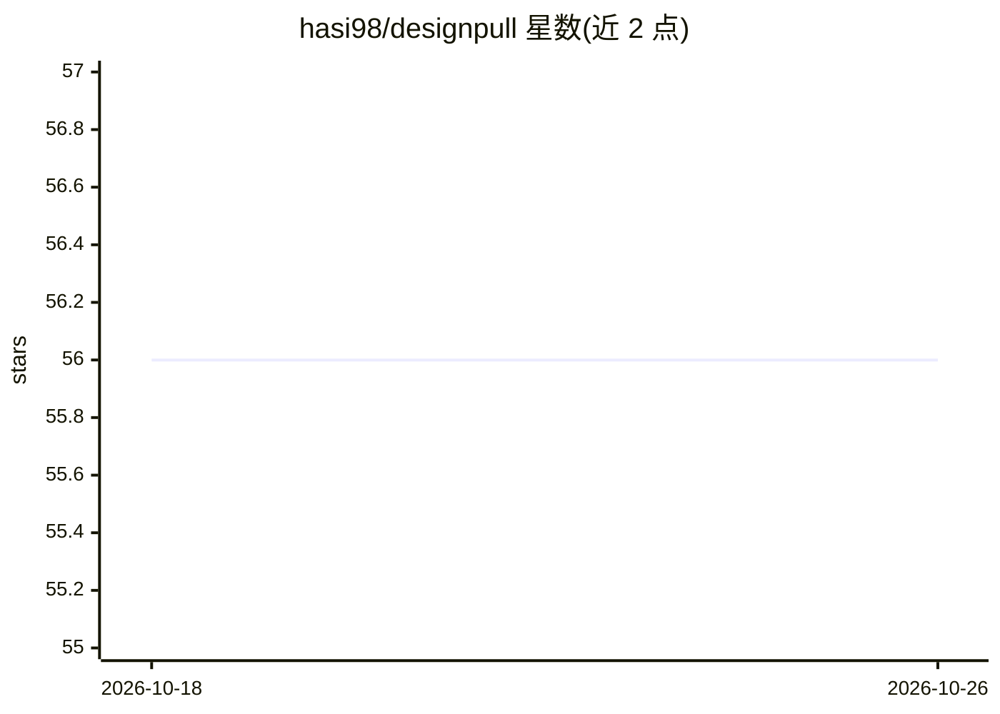

# hasi98/designpull

⭐ 56 · JavaScript · MIT · 推送 2026-05-02 · [GitHub](https://github.com/hasi98/designpull) · 个人维护

**从任意网站生成 Google Stitch 兼容 DESIGN.md 的 Chrome 扩展**

开源 Chrome 扩展：访问任意网站后整页滚动截图并提取 CSS 计算样式，连同 token 发送给用户自选的 AI 视觉模型（Gemini/OpenAI/Claude/Ollama），生成遵循 Google Stitch DESIGN.md 开放规范的文件，含颜色语义角色、版式、摄影风格、品牌语气与 Do's & Don'ts 等 12 个板块。自带 API key 存于浏览器本地，无后端服务器；提供模型选择器、整页/当前视口两种捕获模式与最近 20 条历史。以 git clone 后在 Chrome 加载未打包扩展方式安装。

## 筛选速览

| 维度 | 判定 | 备注 |
|---|---|---|
| AI 角色 | `ai-native` | 本体是模型或模型工具 |
| 许可风险 | `permissive` | MIT |
| 部署形态 | `None` |  |
| 模型依赖 | local-ok | 支持本地模型 |
| 硬件要求 | — | 无带数字的原话,不猜 |
| 安装摩擦 | `low` | 无编译、无系统依赖或容器化 |
| 成熟度 | — | 结构信号不足 |

## 能力要点

- 整页滚动截图拼接 + CSS 计算样式发送给 AI 视觉模型分析
- 输出遵循 Google Stitch DESIGN.md 开放规范（12 个板块）
- 多 provider 支持：Gemini/OpenAI/Claude/Ollama（本地免费）
- 零后端：API key 仅存浏览器本地，保存最近 20 条生成历史

## 适用场景

- 把喜欢的网站设计系统整理成可复用的 DESIGN.md
- 为 Claude Code/Cursor 等 AI 编码代理提供设计规范输入
- 离线（Ollama）或免费额度（Gemini）下提取站点设计语言

## 场景标签

 · 领域:前端/设计工具

## 证据(README 行号)

> L11: **designpull** is an open source Chrome extension that visits any website, extracts its full design system, and gen
> L13: Most existing tools do rule-based CSS extraction. designpull sends a full-page screenshot + extracted tokens to you

## 星数曲线

2026-10-18 56 → 2026-10-26 56（+0）

---
*卡片 v1 · prompt 1.4 · 生成 2026-10-24 · 置信度 high · 依据 README sha `f1eca94acabf` · [字段定义](../../DATASET.md)*
