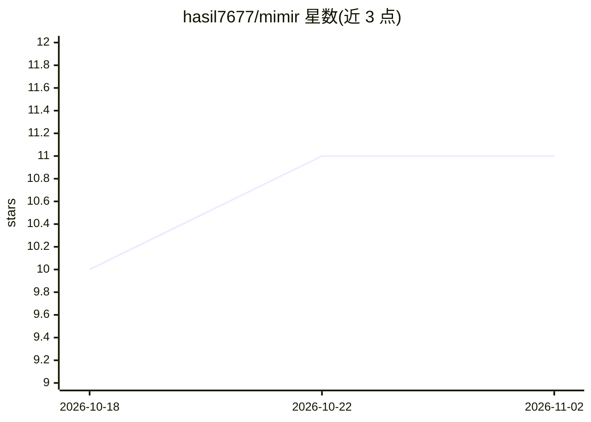

# hasil7677/mimir

⭐ 11 · Python · MIT · 推送 2026-10-11 · [GitHub](https://github.com/hasil7677/mimir) · [官网](https://hasil7677.github.io/mimir/) · 个人维护

**AI agent 本地记忆引擎：记忆即 Obsidian markdown 库**

面向 agent 开发者的本地优先记忆引擎：把对话转录、抽取事实与人类可读笔记存为本地文件，vault（Obsidian markdown + wikilinks）是唯一事实源，DuckDB/Qdrant/Redis 仅作索引且各自可缺失。流程为 capture→flush（LLM 或确定性离线摘要抽取原子事实、去重、标记矛盾）→recall（BM25+向量混合检索、四信号打分）。提供 MCP 工具与 HTTP 契约接入 Claude Code 等 agent；零配置可用，本地或云端模型可选。作者自述早期阶段，公开基准 51.3%（同类 81.8%–86.6%），无图数据库、无 LangChain/OpenAI 适配器。

## 筛选速览

| 维度 | 判定 | 备注 |
|---|---|---|
| AI 角色 | `ai-ecosystem` | LLM/agent 周边工具 |
| 许可风险 | `permissive` | MIT |
| 部署形态 | `library` | 以包/库形式分发 |
| 模型依赖 | — | README 未给出锁定关系 |
| 硬件要求 | — | 无带数字的原话,不猜 |
| 安装摩擦 | `low` | 无编译、无系统依赖或容器化 |
| 成熟度 | `idea` | |

## 能力要点

- 记忆存储为 Obsidian vault（YAML frontmatter + wikilinks），可手动编辑即时生效
- 四存储分层（DuckDB/vault/Qdrant/Redis），除 DuckDB 外均可缺失独立降级
- recall 四信号打分：语义相关性、时间衰减、访问频率、vault 图邻近度
- MCP 三工具（recall/remember/flush）接入 Claude Code 等客户端，零配置无 API key

## 适用场景

- 给我的 AI agent 加上跨会话的长期记忆
- 直接在 Obsidian 里查看并手工修正 agent 记住的事实
- 多个 agent 会话通过网关共享同一份本地记忆库

## 场景标签

`Agent 记忆` · 领域:Agent 开发

## 证据(README 行号)

> L18: Mimir is a memory engine that fixes this **without asking you to run anything.** No cloud account, no Docker, no AP
> L46: A conversation flows through: **capture** (raw turns land in DuckDB, best-effort push to Redis) → **flush** at sess

## 星数曲线

2026-10-18 10 → 2026-11-02 11（+1）

---
*卡片 v1 · prompt 1.4 · 生成 2026-11-02 · 置信度 high · 依据 README sha `2e06284a169c` · [字段定义](../../DATASET.md)*
