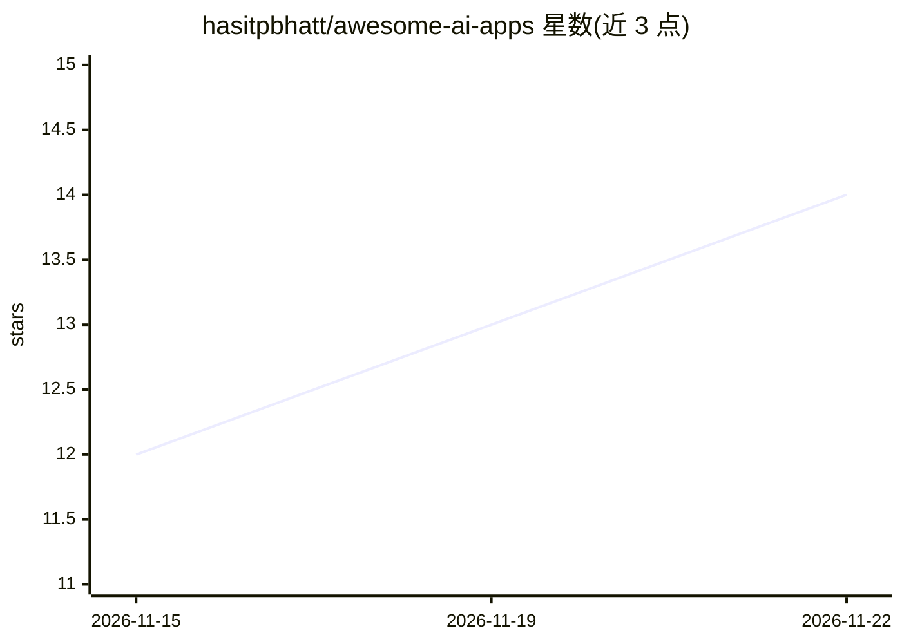

# hasitpbhatt/awesome-ai-apps

⭐ 14 · Python · MIT · 推送 2026-11-16 · [GitHub](https://github.com/hasitpbhatt/awesome-ai-apps) · 个人维护

**面向终端用户的 AI 应用与工具分类精选清单**

一个以 awesome-list 形式维护的 AI 应用清单，将 153 个 AI 应用按 11 个类别组织，覆盖聊天机器人、编程、搜索、写作、图像、视频、音频、生产力与自动化等方向；每条为名称加一句话描述，链接经核验并定期更新。该清单本身不包含代码，不提供安装与运行方式，定位是供用户浏览、发现与选用现成 AI 产品与工具的目录资源。

## 筛选速览

| 维度 | 判定 | 备注 |
|---|---|---|
| AI 角色 | `ai-knowledge` | 知识聚合/清单类 |
| 许可风险 | `permissive` | MIT |
| 部署形态 | `None` |  |
| 模型依赖 | — | README 未给出锁定关系 |
| 硬件要求 | — | 无带数字的原话,不猜 |
| 安装摩擦 | `low` | 无编译、无系统依赖或容器化 |
| 成熟度 | — | 结构信号不足 |

## 能力要点

- 153 个 AI 应用按 11 个类别组织（README 头部另记 127/10 为历史数字）
- 覆盖聊天、编程、搜索、写作、图像、视频、音频、生产力、自动化等类目
- 声明链接经过核验并定期更新

## 适用场景

- 按类别浏览有哪些面向消费者的 AI 应用和工具
- 为某类任务（写作/视频/编程）寻找候选 AI 产品
- 了解 AI 应用生态在各领域的产品分布

## 场景标签

`精选清单` · 领域:学习与行业

## 证据(README 行号)

> L1: # awesome-ai-apps
> L3: A curated list of the best AI applications and tools, organized by category. Updated regularly, verified links, and 
> L10: **Total: 153 AI apps across 11 categories**

## 星数曲线

2026-11-15 12 → 2026-11-22 14（+2）

---
*卡片 v1 · prompt 1.4 · 生成 2026-11-18 · 置信度 high · 依据 README sha `c772d2eeb942` · [字段定义](../../DATASET.md)*
