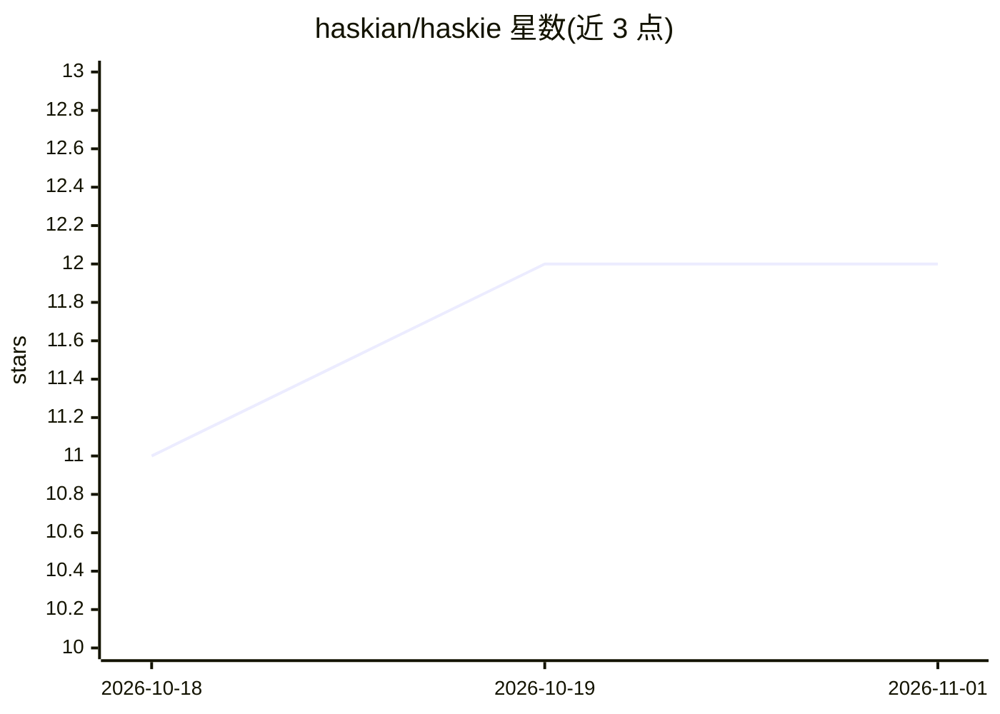

# haskian/haskie

⭐ 12 · Python · MIT · 推送 2026-10-23 · [GitHub](https://github.com/haskian/haskie) · 个人维护

**面向 AI 编程 agent 的本地知识库：整理来源供 agent 检索引用**

本地优先的知识库工具：通过 Web UI 导入并整理 PDF、Office、EPUB、Markdown 等文档，建立语义/混合检索与知识图谱，经 MCP 端点接入 Claude Code 与 Codex，让编程 agent 在回答时检索聚焦段落并引用出处，而非整篇载入上下文。检索支持去重折叠、also_in 来源关联、可选重排与 OCR，文档与模型均留在本机。声明为单用户早期软件，监听 127.0.0.1，不做事实核查，1.0 前部分存储变更需重新导入。

## 筛选速览

| 维度 | 判定 | 备注 |
|---|---|---|
| AI 角色 | `ai-ecosystem` | LLM/agent 周边工具 |
| 许可风险 | `permissive` | MIT |
| 部署形态 | `None` |  |
| 模型依赖 | — | README 未给出锁定关系 |
| 硬件要求 | — | 无带数字的原话,不猜 |
| 安装摩擦 | `low` | 无编译、无系统依赖或容器化 |
| 成熟度 | `idea` | |

## 能力要点

- 语义+混合检索，去重折叠与 also_in 来源关联保留引用链
- 通过 MCP (HTTP) 接入 Claude Code / Codex，一条命令完成集成
- 本地运行：文档、嵌入模型（默认约 390 MB）与 OCR 模型留在本机
- 支持 PDF/Office/EPUB/Markdown/HTML/图片等导入，设备端 OCR

## 适用场景

- 给编程 agent 一个可信的文档库，回答时检索并引用原文段落
- 围绕自家产品规范、业务规则、设计资料组织知识供 agent 使用
- 在 Explore 与 Sessions 中检查 agent 检索到的段落与知识缺口

## 场景标签

`知识库管理` `知识图谱` `RAG` · 领域:知识与检索

## 证据(README 行号)

> L15: haskie connects its web UI, knowledge base and local models to Claude Code and Codex through MCP
> L117: haskie serves the Model Context Protocol (MCP) over HTTP at `http://127.0.0.1:8451/mcp`.
> L51: haskie handles the retrieval part of retrieval-augmented generation (RAG). The agent does the

## 星数曲线

2026-10-18 11 → 2026-11-01 12（+1）

---
*卡片 v1 · prompt 1.4 · 生成 2026-11-01 · 置信度 high · 依据 README sha `8427bdc33056` · [字段定义](../../DATASET.md)*
