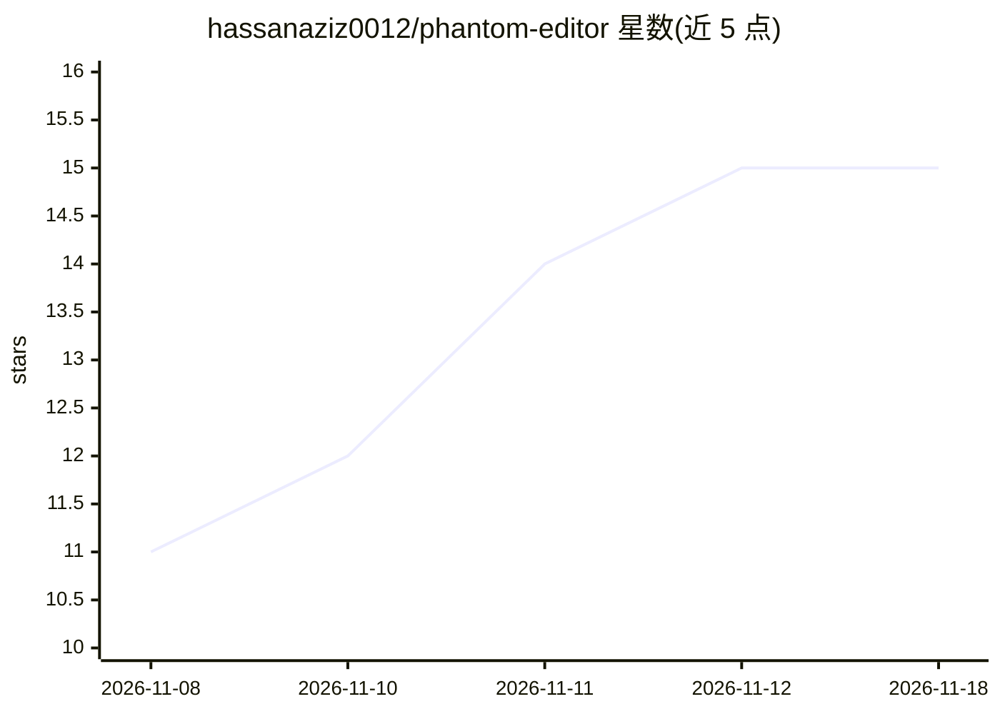

# hassanaziz0012/phantom-editor

⭐ 15 · Python · 推送 2026-11-15 · [GitHub](https://github.com/hassanaziz0012/phantom-editor) · [官网](https://www.hassandev.me/work/phantom-editor) · 个人维护

**供个人内容创作流程的视频/媒体自动化脚本集**

基于 Python 与 ffmpeg 的自动化脚本合集，覆盖视频剪辑、内容创作与其他媒体自动化任务，用于作者本人的 YouTube、Twitter 等平台内容创作流程。脚本分为确定性与 LLM 驱动两类，具体功能需阅读 docs 目录中的各脚本说明。作者声明该工具为持续进行中的项目，会随其创作工作流演进不断更新扩展。README 未提供统一的安装运行入口。

## 筛选速览

| 维度 | 判定 | 备注 |
|---|---|---|
| AI 角色 | `ai-enhanced` | 去掉 AI 部分产品仍成立 |
| 许可风险 | `none` | — |
| 部署形态 | `None` |  |
| 模型依赖 | — | README 未给出锁定关系 |
| 硬件要求 | — | 无带数字的原话,不猜 |
| 安装摩擦 | `low` | 无编译、无系统依赖或容器化 |
| 成熟度 | `idea` | |

## 能力要点

- Python/ffmpeg 自动化脚本合集
- 包含确定性与 LLM 驱动两类脚本
- 面向 YouTube、Twitter 等内容创作平台

## 适用场景

- 自动化视频剪辑与媒体处理任务
- 搭建个人内容创作工作流

## 场景标签

`图像视频处理` · 领域:感知与多模态

## 证据(README 行号)

> L1: Phantom Editor is a big collection of automation scripts (both deterministic and LLM-based) that helps me streamline
> L5: This project is (and probably always will be) a work-in-progress. As my content creation workflow evolves, I continu

## 星数曲线

2026-11-08 11 → 2026-11-18 15（+4）

---
*卡片 v1 · prompt 1.4 · 生成 2026-11-18 · 置信度 low · 依据 README sha `eaaaf62b19d3` · [字段定义](../../DATASET.md)*
