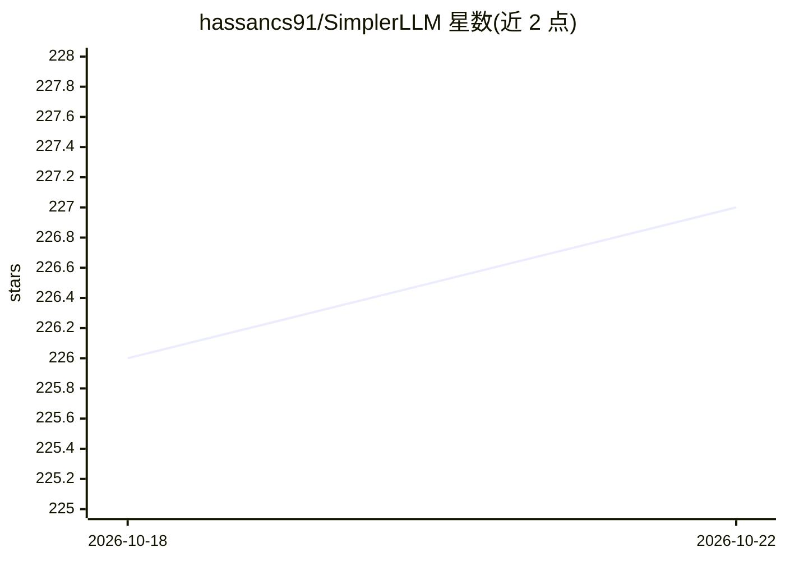

# hassancs91/SimplerLLM

⭐ 227 · Python · MIT · 推送 2026-08-18 · [GitHub](https://github.com/hassancs91/SimplerLLM) · [官网](https://simplerllm.com) · 个人维护

**统一接口接入 11 家 LLM 的 Python 库，含故障转移与结构化输出**

面向研究者、开发者与 AI 爱好者的开源 Python 库：以统一 API 接入 OpenAI、Anthropic、Gemini、Cohere、OpenRouter、CometAPI、DeepSeek、Perplexity、Moonshot、Ollama 与 HuggingFace Local 共 11 家提供商，支持异步调用。提供主备提供商自动故障转移与指数退避重试、Pydantic 校验的结构化 JSON 输出、多提供商 embeddings 与本地/Qdrant 向量库语义检索、AI 驱动的 LLM Router，以及 PDF/网页内容加载、文本分块、搜索 API 集成与提示模板工具。MIT 许可，pip 安装。

## 筛选速览

| 维度 | 判定 | 备注 |
|---|---|---|
| AI 角色 | `ai-ecosystem` | LLM/agent 周边工具 |
| 许可风险 | `permissive` | MIT |
| 部署形态 | `library` | 以包/库形式分发 |
| 模型依赖 | local-ok | 支持本地模型 |
| 硬件要求 | — | 无带数字的原话,不猜 |
| 安装摩擦 | `low` | 无编译、无系统依赖或容器化 |
| 成熟度 | — | 结构信号不足 |

## 能力要点

- 统一 API 接入 11 家 LLM 提供商，经 OpenRouter/CometAPI 可访问 500+ 模型
- ReliableLLM 主备提供商自动故障转移与指数退避重试
- Pydantic 校验的结构化 JSON 输出，校验失败自动重试
- 多提供商 embeddings、本地/Qdrant 向量库与语义检索，及 AI 驱动的 LLM Router

## 适用场景

- 用同一套代码在多家 LLM 提供商之间切换
- 应用需要一个提供商故障时自动切换到备用提供商
- 生成经 Pydantic 校验的结构化 JSON 数据
- 在本地或 Qdrant 向量库上做语义检索

## 场景标签

`模型网关` · 领域:Agent 开发

## 证据(README 行号)

> L12: SimplerLLM is an open-source Python library designed to simplify interactions with Large Language Models (LLMs) for
> L34: - **11 LLM Providers**: OpenAI, Anthropic, Google Gemini, Cohere, OpenRouter, CometAPI, DeepSeek, Perplexity, Moons

## 星数曲线

2026-10-18 226 → 2026-10-22 227（+1）

---
*卡片 v1 · prompt 1.4 · 生成 2026-10-22 · 置信度 high · 依据 README sha `36f7fa38bbaa` · [字段定义](../../DATASET.md)*
