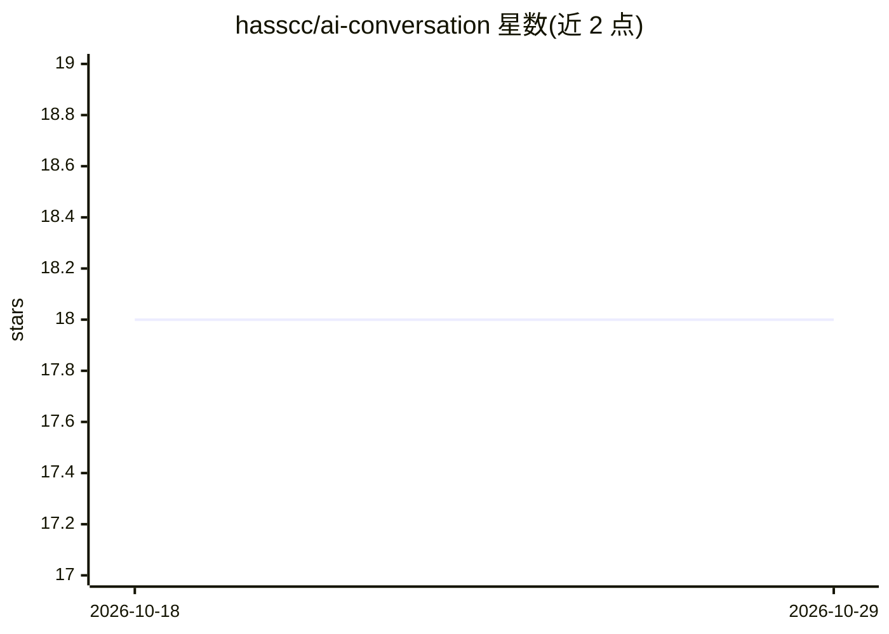

# hasscc/ai-conversation

⭐ 18 · Python · 推送 2026-04-09 · [GitHub](https://github.com/hasscc/ai-conversation) · 个人维护 · 中文 README

**Home Assistant 的 AI 对话组件：接入 OpenAI 格式 LLM，支持 STT/TTS**

Home Assistant 自定义组件，通过配置服务与模型接入任意 OpenAI 格式的 LLM 提供商，并支持对话、STT、TTS 模型组合，作为 HA 的对话代理使用。提供 explain_media 等 action，并内置 MCP Server，可将智能家居需求通过 SSE 接口转发给 MCP 客户端 LLM 应用（需 Long-lived access token）。安装方式包括 HACS、手动复制文件、SSH 一键脚本与 shell_command 服务四种。

## 筛选速览

| 维度 | 判定 | 备注 |
|---|---|---|
| AI 角色 | `ai-ecosystem` | LLM/agent 周边工具 |
| 许可风险 | `none` | — |
| 部署形态 | `None` |  |
| 模型依赖 | — | README 未给出锁定关系 |
| 硬件要求 | — | 无带数字的原话,不猜 |
| 安装摩擦 | `low` | 无编译、无系统依赖或容器化 |
| 成熟度 | — | 结构信号不足 |

## 能力要点

- 兼容任意 OpenAI 格式 LLM 提供商，支持对话/STT/TTS 模型配置
- 内置 MCP Server，供外部 MCP 客户端 LLM 应用调用 HA 对话代理
- 提供 explain_media 等实体动作
- HACS/手动/一键脚本/shell_command 四种安装途径

## 适用场景

- 在 Home Assistant 中接入自选 LLM 作为对话代理
- 通过语音（STT/TTS）与智能家居对话
- 让 MCP 客户端 LLM 应用调用 HA 对话代理控制家居

## 场景标签

`聊天机器人` `语音 Agent` · 领域:对话与助手

## 证据(README 行号)

> L1: # 🤖 AI Conversation Agent
> L45: This component provides an MCP server to pass the user's smart home needs to the Home Assistant's conversation agen

## 星数曲线

2026-10-18 18 → 2026-10-29 18（+0）

---
*卡片 v1 · prompt 1.4 · 生成 2026-10-29 · 置信度 mid · 依据 README sha `dd234def1c4e` · [字段定义](../../DATASET.md)*
