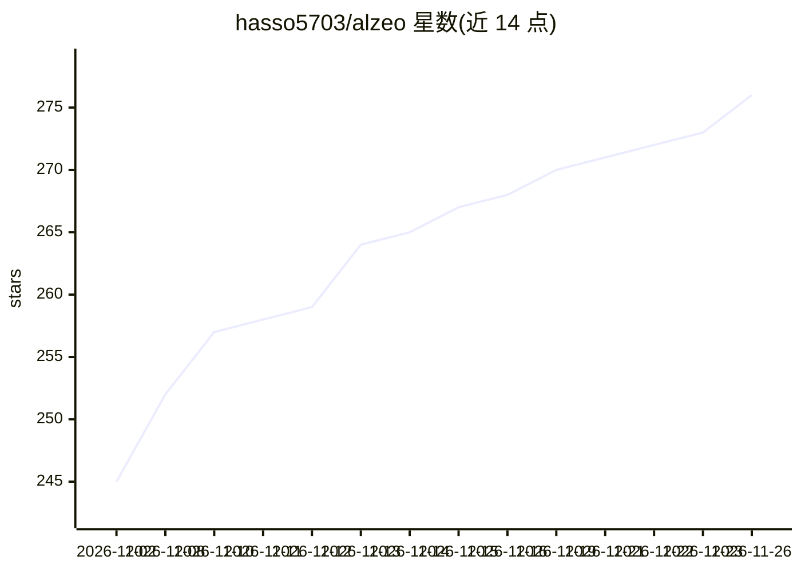

# hasso5703/alzeo

⭐ 276 · Python · MIT · 推送 2026-11-24 · [GitHub](https://github.com/hasso5703/alzeo) · [官网](https://alzeo.ai) · 个人维护

**一条命令把 DGX Spark/GB10 机器装成本地私有 AI 服务器**

开源安装器，通过 curl 一行命令或 clone 后运行 install.sh，在 NVIDIA DGX Spark 或其他 GB10 机器（ASUS、Dell、HP、Lenovo、MSI 等）上安装自启动的服务栈：15 条按统一内存池轮流加载的模型 lane，提供 OpenAI 与 Anthropic 兼容 API 和浏览器 Cockpit（笔记本/手机访问）。模型以 digest/revision 固定并在安装结束前验证。限制：面向 GB10 硬件，内存池耗尽会冻结系统需断电重启，README 未提供安装包以外的其他平台支持。

## 筛选速览

| 维度 | 判定 | 备注 |
|---|---|---|
| AI 角色 | `ai-ecosystem` | LLM/agent 周边工具 |
| 许可风险 | `permissive` | MIT |
| 部署形态 | `self-host` | docker 或自建部署 |
| 模型依赖 | local-ok | 支持本地模型 |
| 硬件要求 | — | 无带数字的原话,不猜 |
| 安装摩擦 | `low` | 无编译、无系统依赖或容器化 |
| 成熟度 | — | 结构信号不足 |

## 能力要点

- 一条命令安装全部服务栈并支持同一命令更新
- 15 条模型 lane 共享 128 GB 统一内存池轮流加载
- 提供 OpenAI 与 Anthropic 兼容 API
- 本地 Cockpit 从浏览器管理内存占用与 lane 切换

## 适用场景

- 把 DGX Spark/GX10 机器配置成不外发数据的私有 AI 服务器
- 本地跑文本生成、图像生成、视频生成与语音识别
- 在笔记本和手机上管理本地模型的加载与切换

## 场景标签

`图像生成` `视频生成` `语音识别` `推理引擎` · 领域:内容生成

## 证据(README 行号)

> L1: # Alzeo: one command turns a DGX Spark into a private AI server
> L36: **Why this rather than a recipe.** A recipe starts one model. On a Spark the hard part comes
> L44: - **One pool, lanes that take turns.** The cockpit shows what holds the memory and loads a lane

## 星数曲线

2026-11-02 245 → 2026-11-26 276（+31）

---
*卡片 v1 · prompt 1.4 · 生成 2026-11-26 · 置信度 mid · 依据 README sha `6a617cc5dca4` · [字段定义](../../DATASET.md)*
