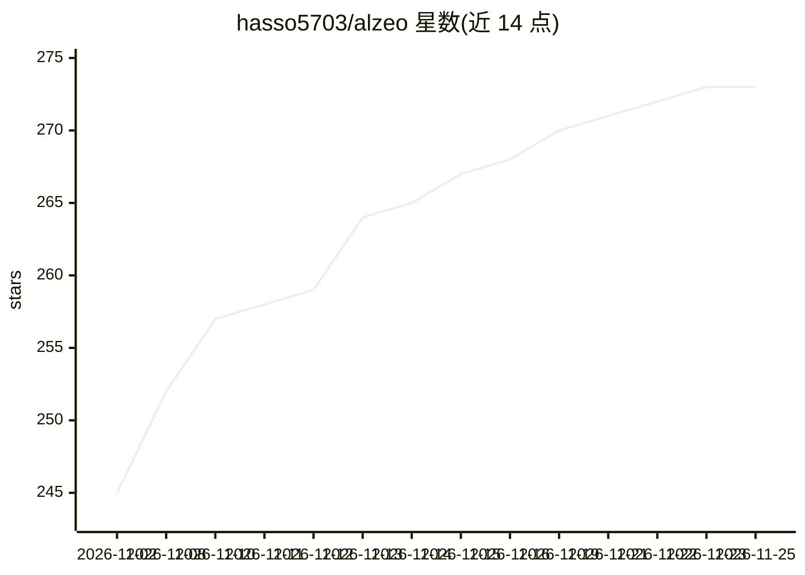

# hasso5703/alzeo

⭐ 273 · Python · MIT · 推送 2026-11-23 · [GitHub](https://github.com/hasso5703/alzeo) · [官网](https://alzeo.ai) · 个人维护

**一条命令把 DGX Spark/GB10 机器装成本地私有 AI 服务器**

Alzeo 是面向 DGX Spark 及其他 GB10 机器的开源安装器，一条命令安装本地 AI 服务栈：提供 OpenAI 与 Anthropic 兼容 API、本地驾驶舱（cockpit），以及十四条在同一统一内存池中轮流加载的模型通道，覆盖文本、图像、视频生成、语音与类型化概率端点。通道按 digest/revision 固定并在安装结束前验证，附基准测量方法文档。适用对象为拥有该硬件、希望模型与数据不出本机运行的个人或团队。

## 筛选速览

| 维度 | 判定 | 备注 |
|---|---|---|
| AI 角色 | `ai-ecosystem` | LLM/agent 周边工具 |
| 许可风险 | `permissive` | MIT |
| 部署形态 | `self-host` | docker 或自建部署 |
| 模型依赖 | local-ok | 支持本地模型 |
| 硬件要求 | — | 无带数字的原话,不猜 |
| 安装摩擦 | `low` | 无编译、无系统依赖或容器化 |
| 成熟度 | — | 结构信号不足 |

## 能力要点

- 一条命令安装并更新整个本地 AI 服务栈与驾驶舱
- OpenAI 与 Anthropic 兼容 API，opencode/Claude Code/Cursor 等客户端开箱接入
- 十四条模型通道轮流共享一个内存池，Load 按钮从浏览器切换
- 通道按 digest 固定并在服务前验证，基准数字附方法文档

## 适用场景

- 在 DGX Spark/GB10 上搭建数据不出本机的私有 AI 服务
- 一台机器上轮流运行文本、图像、视频多个模型
- 为本地开发工具（opencode、Claude Code、Cursor）接入本地模型

## 场景标签

`推理引擎` `图像生成` `视频生成` · 领域:内容生成

## 证据(README 行号)

> L1: # Alzeo: one command turns a DGX Spark into a private AI server
> L36: **Why this rather than a recipe.** A recipe starts one model. On a Spark the hard part comes
> L84: One command installs a boot-persistent, hardened serving stack on a single DGX Spark,

## 星数曲线

2026-11-02 245 → 2026-11-25 273（+28）

---
*卡片 v1 · prompt 1.4 · 生成 2026-11-25 · 置信度 mid · 依据 README sha `2c71b25c1f2e` · [字段定义](../../DATASET.md)*
