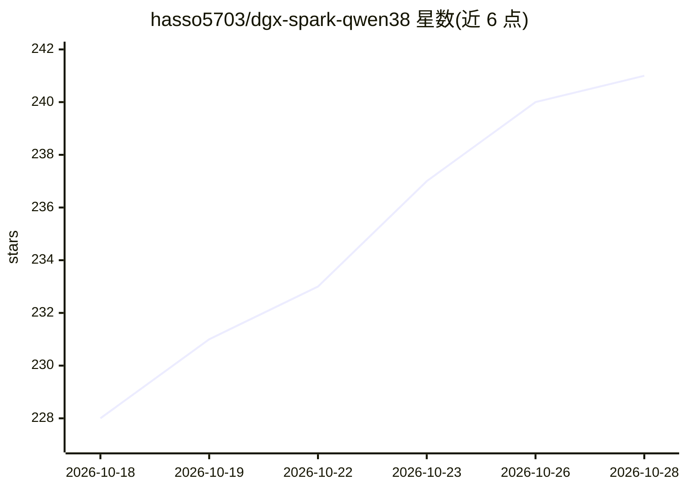

# hasso5703/dgx-spark-qwen38

⭐ 242 · Python · MIT · 推送 2026-10-26 · [GitHub](https://github.com/hasso5703/dgx-spark-qwen38) · [官网](https://hasso5703.github.io/) · 个人维护

**一条命令把 DGX Spark/GB10 变成私有 AI 服务器**

面向 NVIDIA DGX Spark 与 ASUS Ascent GX10（GB10）单机的安装与管理系统：一条命令安装固化镜像与模型检查点，构建最多八条可切换的服务通道（Qwen3.8 系列 27B/176B 文本、Qwen-Image 2.1 图像、MiniMax-H3 视频、Kolibri-1、Nemotron 3.5 系列、语音等），通过浏览器 Cockpit 从笔记本或手机管理统一内存池中轮流加载的通道。提供 OpenAI 兼容与 Anthropic 协议 API，opencode、Claude Code、VS Code Copilot、Open WebUI、Cursor 等客户端开箱可用。所有数据不离开本机。限制：仅支持 GB10 硬件，基准数字在参考机型上测得。

## 筛选速览

| 维度 | 判定 | 备注 |
|---|---|---|
| AI 角色 | `ai-ecosystem` | LLM/agent 周边工具 |
| 许可风险 | `permissive` | MIT |
| 部署形态 | `self-host` | docker 或自建部署 |
| 模型依赖 | — | README 未给出锁定关系 |
| 硬件要求 | — | 无带数字的原话,不猜 |
| 安装摩擦 | `low` | 无编译、无系统依赖或容器化 |
| 成熟度 | — | 结构信号不足 |

## 能力要点

- 一条命令安装固化（digest/revision 锁定）的多模型服务栈，安装时自证可用
- 八条通道共享 128 GB 统一内存池，Cockpit 一键切换加载
- OpenAI 兼容与 Anthropic 协议 API，多种 agent 客户端开箱配置
- 每项性能数字附测量方法（BENCHMARKS.md），可跨启动复现

## 适用场景

- 把 DGX Spark/GX10 一键变成家庭或团队的私有 LLM/图像/视频服务器
- 在同一台机器上按需切换 27B、176B 等不同模型与目标配置
- 让 opencode、Claude Code、Cursor 等客户端直接连本地模型

## 场景标签

`图像生成` `视频生成` `推理引擎` · 领域:内容生成

## 证据(README 行号)

> L12: curl -fsSL https://raw.githubusercontent.com/hasso5703/dgx-spark-qwen38/main/get.sh | bash
> L34: - **Clients that work out of the box.** OpenAI- and Anthropic-compatible APIs, opencode wired to
> L78: built at its first Load from the cockpit (`--all-weights` builds and proves them all at install). One cockpit drive

## 星数曲线

2026-10-18 228 → 2026-10-28 241（+13）

---
*卡片 v1 · prompt 1.4 · 生成 2026-10-22 · 置信度 mid · 依据 README sha `a1708dfc5bc1` · [字段定义](../../DATASET.md)*
