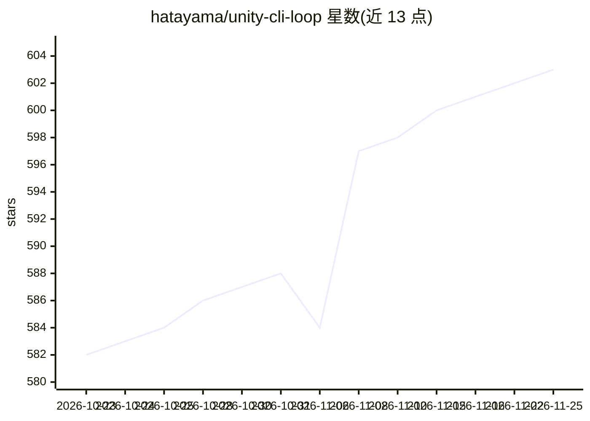

# hatayama/unity-cli-loop

⭐ 603 · C# · MIT · 推送 2026-11-24 · [GitHub](https://github.com/hatayama/unity-cli-loop) · 个人维护

**让 LLM 工具经 CLI 驱动 Unity 项目的编译、测试与运行**

Unity 集成工具，通过 uloop CLI 与 Unity 包向 Claude Code、Codex 等 LLM 工具暴露 21 个技能，使 AI 代理自主执行编译、运行测试、读取日志、操作场景、截图核验 UI，并在 Play Mode 中模拟键鼠输入与回放录制输入。V3 提供 pause-point 在任意源码行暂停并读取变量、hot-reload 无需重编译即时应用方法体修改。需 Unity 2022.3+，支持脚本安装器、Homebrew、OpenUPM 与 Unity UI 安装，Linux 不支持 focus-window。

## 筛选速览

| 维度 | 判定 | 备注 |
|---|---|---|
| AI 角色 | `ai-ecosystem` | LLM/agent 周边工具 |
| 许可风险 | `permissive` | MIT |
| 部署形态 | `library` | 以包/库形式分发 |
| 模型依赖 | — | README 未给出锁定关系 |
| 硬件要求 | — | 无带数字的原话,不猜 |
| 安装摩擦 | `medium` | 含编译或系统依赖之一 |
| 成熟度 | — | 结构信号不足 |

## 能力要点

- 21 个捆绑技能覆盖编译、测试、日志、场景、截图与输入模拟
- pause-point 在任意源码行暂停并返回该帧变量与调用路径
- hot-reload 在运行中的游戏中即时应用方法体修改
- 提供 curl 脚本、Homebrew、OpenUPM 与 Unity UI 多种安装途径

## 适用场景

- 让 AI 代理在 Unity 项目中编译、修测试失败并验证运行效果
- 在 Play Mode 中由 AI 点击按钮、按键并截图核验 UI 布局
- 不停下重编译即在运行中的游戏里应用并测试代码修改
- 断点暂停在指定源码行读取变量定位问题原因

## 场景标签

`编码 Agent` `GUI 自动化` · 领域:效率与自动化

## 证据(README 行号)

> L16: Let an AI agent compile, test, and operate your Unity project from popular LLM tools via CLI.
> L25: Unity CLI Loop is a Unity integration tool designed so that **AI can drive your Unity project forward with minimal 
> L95: This guide installs three things — the CLI, the Unity package, and the skills — so that your LLM tool can drive Uni

## 星数曲线

2026-10-23 582 → 2026-11-25 603（+21）

---
*卡片 v1 · prompt 1.4 · 生成 2026-11-25 · 置信度 mid · 依据 README sha `8a9ef284fa2a` · [字段定义](../../DATASET.md)*
