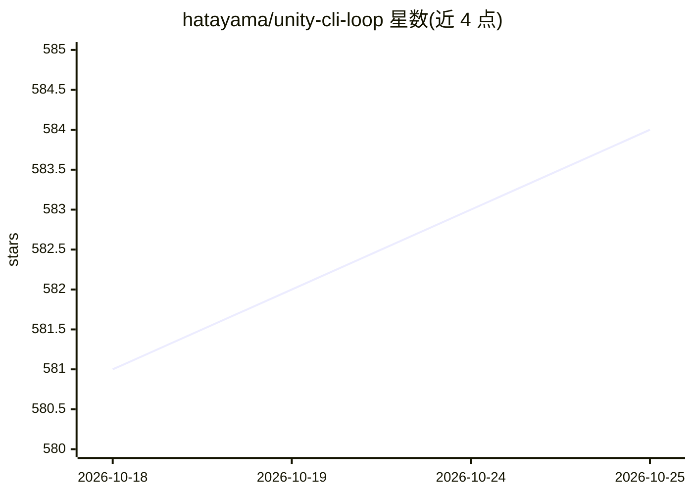

# hatayama/unity-cli-loop

⭐ 584 · C# · MIT · 推送 2026-10-25 · [GitHub](https://github.com/hatayama/unity-cli-loop) · 个人维护

**让 LLM 工具通过 CLI 驱动 Unity 项目的集成工具**

由 CLI、Unity 包与技能（Skills）三部分组成的 Unity 集成工具：LLM 工具（如 Claude Code、Codex）通过 uloop 命令连接 Unity Editor 内的 IPC 服务器（Unix domain socket / 命名管道，无 TCP 端口），实现自主编译、跑测试、读日志、操作场景、截图验证 UI、PlayMode 输入模拟与暂停断点读变量等开发循环，内置 23 个技能；设计上以 execute-dynamic-code 一个工具覆盖大部分 Editor 操作以节省 token。要求 Unity 2022.3+，V3 无需 Node.js。

## 筛选速览

| 维度 | 判定 | 备注 |
|---|---|---|
| AI 角色 | `ai-ecosystem` | LLM/agent 周边工具 |
| 许可风险 | `permissive` | MIT |
| 部署形态 | `library` | 以包/库形式分发 |
| 模型依赖 | locked-api |  |
| 硬件要求 | — | 无带数字的原话,不猜 |
| 安装摩擦 | `medium` | 含编译或系统依赖之一 |
| 成熟度 | — | 结构信号不足 |

## 能力要点

- AI 自主完成编译、测试、日志检查、修复的开发循环
- hot-reload 即时应用方法体修改，pause-point 暂停读取变量
- PlayMode 输入模拟、截图与录制回放验证游戏行为
- CLI 经 Unix socket/命名管道连接 Editor，无端口配置

## 适用场景

- 让 Claude Code/Codex 等 LLM 工具自主迭代 Unity 项目开发
- AI 在 PlayMode 中模拟点击键盘操作并验证功能
- 让 AI 通过截图检查和调整 UI 布局
- 自动运行测试并分析失败原因

## 场景标签

`编码 Agent` · 领域:编码与开发

## 证据(README 行号)

> L16: Let an AI agent compile, test, and operate your Unity project from popular LLM tools via CLI.
> L25: Unity CLI Loop is a Unity integration tool designed so that **AI can drive your Unity project forward with minimal 
> L224: A `uloop` command reaches the Unity Editor through the following chain:

## 星数曲线

2026-10-18 581 → 2026-10-25 584（+3）

---
*卡片 v1 · prompt 1.4 · 生成 2026-10-21 · 置信度 mid · 依据 README sha `0aac87f6444e` · [字段定义](../../DATASET.md)*
