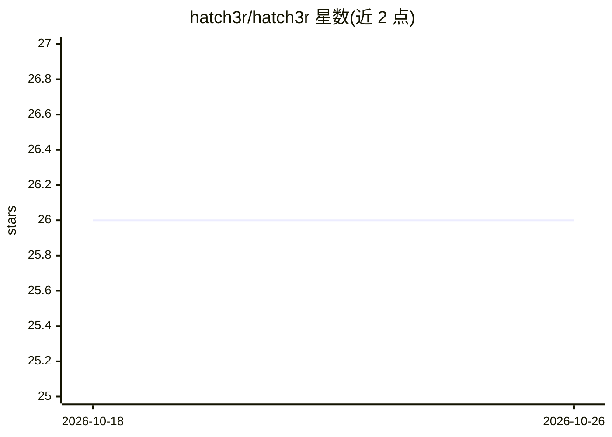

# hatch3r/hatch3r

⭐ 26 · TypeScript · MIT · 推送 2026-09-25 · [GitHub](https://github.com/hatch3r/hatch3r) · [官网](https://docs.hatch3r.com) · 个人维护

**一条命令向代码仓库安装适配 3 平台的 agentic 编码配置**

开源 CLI 与编辑器插件：通过 npx hatch3r init 向任意仓库安装工具无关的 agentic 编码套件，包含 30 个 agents、55 个 skills、74 条 rules、33 个命令、29 个 CLI 工具及 10 个可选 MCP 服务器，输出到 Claude Code、Cursor、GitHub Copilot 三种适配器，平台（GitHub/Azure DevOps/GitLab）由 git remote 自动检测。内容分级为 minimal/standard/full/custom 四种 profile，canonical 内容打包在 npm 包内，仓库中仅留 .hatch3r/ 目录。需要 Node.js 22.13+。1.9.0 起硬性移除 12 个适配器，仅支持上述 3 种。

## 筛选速览

| 维度 | 判定 | 备注 |
|---|---|---|
| AI 角色 | `ai-ecosystem` | LLM/agent 周边工具 |
| 许可风险 | `permissive` | MIT |
| 部署形态 | `library` | 以包/库形式分发 |
| 模型依赖 | — | README 未给出锁定关系 |
| 硬件要求 | — | 无带数字的原话,不猜 |
| 安装摩擦 | `low` | 无编译、无系统依赖或容器化 |
| 成熟度 | — | 结构信号不足 |

## 能力要点

- 一条命令安装 agents/skills/rules/commands/hooks/MCP 全套配置
- 3 平台适配器：Claude Code、Cursor、GitHub Copilot
- 支持从 Cursor/Copilot/Windsurf/cursorrules/AGENTS.md 导入既有规则
- board 工作流：todo.md 解析、依赖 DAG、自动选任务开 PR、reviewer+fixer 循环、semver 发布

## 适用场景

- 为我的仓库快速配置一整套 AI 编码 agent 工作流
- 把我在 Cursor/Copilot 里的既有规则迁移到统一格式
- 用 board 命令从 todo.md 建看板并驱动实现-评审-发布流程

## 场景标签

`编码 Agent` · 领域:编码与开发

## 证据(README 行号)

> L7: hatch3r is an open-source CLI and editor plugin (Claude Code + Cursor) that installs a tool-agnostic agentic coding 
> L36: ## Supported Tools (3 Adapters)
> L44: Platform is auto-detected from your git remote during `hatch3r init`. All board commands, agents, rules, and skills

## 星数曲线

2026-10-18 26 → 2026-10-26 26（+0）

---
*卡片 v1 · prompt 1.4 · 生成 2026-10-26 · 置信度 high · 依据 README sha `0c2adbe9601d` · [字段定义](../../DATASET.md)*
