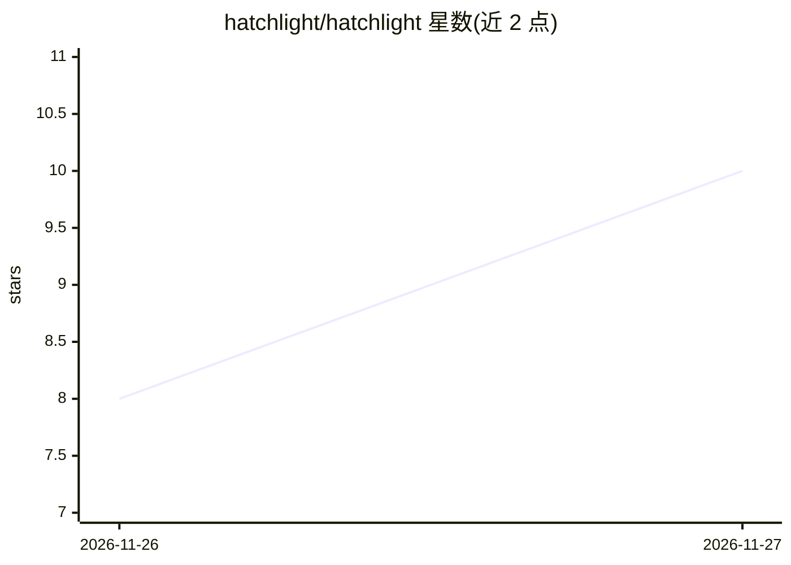

# hatchlight/hatchlight

⭐ 10 · TypeScript · MIT · 推送 2026-11-26 · [GitHub](https://github.com/hatchlight/hatchlight) · [官网](https://hatchlight.app/) · 组织维护

**在本机 GPU 或自有 API key 上并排对比多个 AI 图像/视频模型**

Hatchlight 是一个开源图像与视频生成工具，提供桌面应用、CLI、Docker 服务器与 MCP 服务器四种形态。核心机制是将同一提示词发送给多个模型并排展示结果及各自耗时与花费，并按用户选择对模型排序。本地模型按显卡自动选择合适的量化版本（16/8/4 bit），云端模型使用用户自己的 key 直连；结果与密钥数据保留在本机，无账号与遥测。LoRA 训练仅限 Windows/WSL 与 NVIDIA 12 GB 显存。

## 筛选速览

| 维度 | 判定 | 备注 |
|---|---|---|
| AI 角色 | `ai-native` | 本体是模型或模型工具 |
| 许可风险 | `permissive` | MIT |
| 部署形态 | `None` |  |
| 模型依赖 | locked-api |  |
| 硬件要求 | — | 无带数字的原话,不猜 |
| 安装摩擦 | `medium` | 含编译或系统依赖之一 |
| 成熟度 | — | 结构信号不足 |

## 能力要点

- 同一提示词发送多模型并排对比，显示耗时与花费，可盲选排序
- 本地运行 SDXL、FLUX、Qwen-Image、Wan 2.1/2.2 等图像与视频模型，含多档量化版本
- LoRA 加载与 SDXL LoRA 训练，可复用 ComfyUI/AUTOMATIC1111/Forge/Stability Matrix 目录
- MCP 服务器与 OpenAI 图像 API 兼容层，供 Claude Code、Open WebUI 等调用

## 适用场景

- 用一张卡并排比较多个生成模型的效果、速度和成本
- 在无账号、数据不出本机的前提下生成图片和视频
- 训练自己的 SDXL LoRA 并管理角色与风格
- 让 AI agent 或其他应用（SillyTavern 等）调用本机模型生成图片

## 场景标签

`图像生成` `视频生成` `微调` · 领域:内容生成

## 证据(README 行号)

> L16: Make pictures and videos with many AI models, side by side. Run them on your
> L44: **Models on your computer.** Picture and video models from the catalog, many
> L83: 16:9, with FLUX". It picks models, writes the prompts and makes the pictures.

## 星数曲线

2026-11-26 8 → 2026-11-27 10（+2）

---
*卡片 v1 · prompt 1.4 · 生成 2026-11-26 · 置信度 high · 依据 README sha `ff77317b6062` · [字段定义](../../DATASET.md)*
