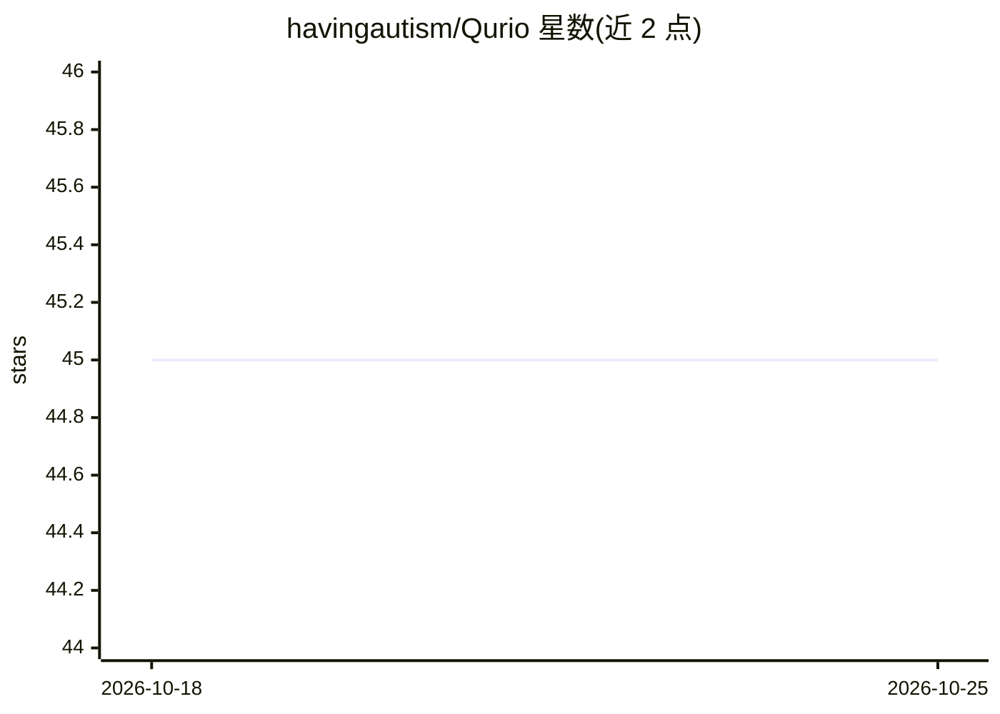

# havingautism/Qurio

⭐ 45 · JavaScript · NOASSERTION · 推送 2026-06-25 · [GitHub](https://github.com/havingautism/Qurio) · [官网](https://havingautism.github.io/Qurio/) · 个人维护 · 中文 README

**自托管多模型 AI 知识工作台：深度研究、Agent 与工具编排**

面向团队的自托管 AI 工作区 Web 应用：接入 OpenAI 兼容端点、Gemini、SiliconFlow、Kimi、MiniMax、GLM、NVIDIA NIM 等多提供商，采用 Lite/Default 双模型槽分工（轻模型做路由规划，强模型做回答）。功能含 Deep Research 研究流程（计划-执行-带引用报告）、自定义 Agent、MCP 与 HTTP 工具分组管控、文档混合检索（向量+关键词）、域索引长期记忆。需 Bun 1.3+ 与 Supabase 项目，搜索功能依赖 Tavily API key；许可为非商业用途。

## 筛选速览

| 维度 | 判定 | 备注 |
|---|---|---|
| AI 角色 | `ai-native` | 本体是模型或模型工具 |
| 许可风险 | `none` | NOASSERTION |
| 部署形态 | `None` |  |
| 模型依赖 | — | README 未给出锁定关系 |
| 硬件要求 | — | 无带数字的原话,不猜 |
| 安装摩擦 | `low` | 无编译、无系统依赖或容器化 |
| 成熟度 | — | 结构信号不足 |

## 能力要点

- 多提供商接入与 Lite/Default 双模型槽分工
- Deep Research：结构化计划、带时间戳引用的迭代式研究报告
- MCP 工具组 + 自定义 HTTP 工具，按工具粒度启停
- 域索引长期记忆：轻模型门控选择性注入

## 适用场景

- 在自托管环境中聚合多家模型做研究与问答
- 搭建带外部工具（MCP/HTTP）的专用 Agent 工作流
- 基于上传文档做带检索依据的问答与报告导出

## 场景标签

`Agent 记忆` `科研工具` `文档问答` · 领域:Agent 开发

## 证据(README 行号)

> L13: **Qurio** is a high-velocity AI knowledge workspace built for teams that demand more than basic chat. It supports g
> L39: - **Deep Research, Not Just Search**: Dedicated research workflow that plans, executes, and reports with structured
> L64: - **Automated Research Pipeline**: Deep Research mode breaks down complex research goals into structured plans, con

## 星数曲线

2026-10-18 45 → 2026-10-25 45（+0）

---
*卡片 v1 · prompt 1.4 · 生成 2026-10-25 · 置信度 high · 依据 README sha `2c33bacc9b4f` · [字段定义](../../DATASET.md)*
